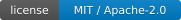

# axess-identity

[](https://crates.io/crates/axess-identity)
[](https://github.com/GnomesOfZurich/axess)
[](https://github.com/GnomesOfZurich/axess#licence)

[crates.io](https://crates.io/crates/axess-identity) · [docs.rs](https://docs.rs/axess-identity) · [Book](https://gnomesofzurich.github.io/axess/) · [GitHub](https://github.com/GnomesOfZurich/axess)

Identity primitives for the [Axess](https://github.com/GnomesOfZurich/axess) workspace.

Foundation crate, deliberately small: depends only on [`axess-rng`](https://crates.io/crates/axess-rng) (for the DST-injectable `SecureRng` trait), `uuid`, `thiserror`, and `sha2` (a session's key is a SHA-256 of its id). No tokio, no axum, no Cedar; axess-core layers session integration + Cedar entity emission on top of these primitives.

## What's in here

- **Typed identifiers**; `TenantId`, `UserId`, `DeviceId`, `SessionId`, `EventId`. All `FooId(Uuid)` newtypes via the `define_id!` macro, with optional `serde` / `rkyv` / `sqlx` derives gated by features on the umbrella `axess-core` crate.
- **The session key**; `SessionKey`, the SHA-256 of a fixed tag and a `SessionId`, 64 lowercase hexadecimal characters. A session store, a registry, an audit record, a log line and a `HumanPrincipal` name a session by it, so none of them holds a value a cookie could carry. `SessionKey::of` is the one way from an id to its key; `SessionKey::from_recorded` reads a record an earlier release wrote with the id in it.
- **Text for a log line**; `log_text::escapes` names what outside text may not carry raw into a log line or an error (control characters, the line and paragraph separators, bidirectional controls, zero-width characters, the byte order mark, the Hangul fillers), and `log_text::log_safe` escapes and bounds such text. Every axess crate uses this one predicate.
- **Principal abstraction**; unified `Principal { Human, Workload }` enum + the SPIFFE-shaped `WorkloadId` / `TrustDomain` / `Issuer` types, plus the async `PrincipalResolver` trait every inbound auth surface implements. See [`docs/workload-identity/README.md`](https://github.com/GnomesOfZurich/axess/blob/main/docs/workload-identity/README.md) for the design rationale.

## Usage

```rust
use axess_identity::{TenantId, UserId, define_id};

let tenant = TenantId::new();              // fresh v4 UUID
let user = UserId::new();
let parsed: TenantId = "0193...".parse()?; // FromStr from hyphenated string

// Adopters can mint their own ID types:
define_id!(InvoiceId);
```

## Licence

Dual-licensed under [MIT](https://github.com/GnomesOfZurich/axess/blob/main/LICENSE-MIT) and [Apache-2.0](https://github.com/GnomesOfZurich/axess/blob/main/LICENSE-APACHE).
