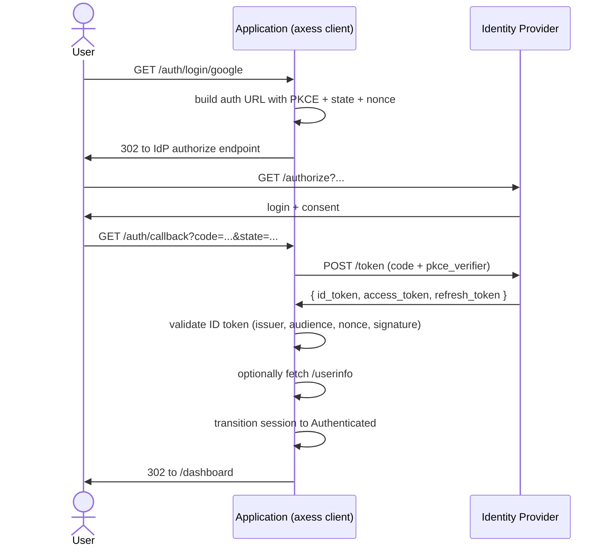

# OAuth 2.0 and OIDC

Federated login through an Identity Provider you do not control is
the most common reason adopters reach for OAuth. The user has a
Google account, an Okta account, a corporate Azure AD account, and
you accept a login from any of them rather than asking
the user to invent and remember another password. The mechanism is
OAuth 2.0 for the authorisation flow and OpenID Connect for the
identity assertion layered on top. The division of labour is the thing
to hold on to: what axess wires up, and what your integration code still
owns.

The feature flag is `oauth` (off by default), enabled with
`features = ["oauth", "jwt-rust-crypto"]` on the `axess` facade. `oauth`
transitively enables `oidc` (the discovery and JWKS-cache machinery) and `jwt`
(the ID token validator), and `jwt` needs a crypto backend named beside it:
`jwt-rust-crypto` (pure Rust) or `jwt-aws-lc` (FIPS-capable, needs a C
toolchain).

Axess supports generic OIDC-based external login and SSO, including standard providers such as Google and Microsoft Entra ID when configured with the appropriate issuer metadata and client credentials. SAML / Shibboleth federation is not currently supported out of the box.

## The shape of the flow

A federated login involves the user, the application (the OAuth
client, in OAuth language, which is axess), and the Identity Provider
(the OAuth server, which is the third-party IdP). The flow is the
authorisation code grant with PKCE, which is what every modern OIDC
deployment uses.



Axess owns six pieces of the flow:

- the PKCE verifier and challenge
- the CSRF state, generated and bound
- the OIDC nonce, generated and bound
- discovery of the IdP's endpoints and signing keys
- the token exchange
- ID token validation: signature, audience, nonce, and `azp` when the
  audience is multi-valued

Your integration owns three:

- the redirect to the IdP authorize URL
- the callback handler that picks up the code
- mapping validated claims onto a user record in your identity store

## Configuring a provider

You do not implement the trait; `discover` reads the IdP's own document into a
builder, and `build` checks its settings and returns the provider.

### The provider

`OAuthProvider` is the trait that represents an IdP. The trait is
asynchronous because every method may need to fetch JWKS, perform
discovery, or hit the token endpoint. Adopters do not implement this
trait themselves under normal circumstances; the
`OAuthProviderConfig` constructor in `axess-factors` produces a
provider from a discovery URL plus client credentials, and the
returned provider implements the trait.

```rust,ignore
let provider = OAuthProviderConfig::discover(
    "google",
    "https://accounts.google.com",
    client_id,
    client_secret,
    "https://your-app.example.com/auth/callback/google",
)
.await?
.build()?;
```

`discover` returns an `OAuthProviderBuilder`. Its `with_*` methods record a
setting and return the builder, in any order; `build` is the one place the
settings meet. It checks the transport of every endpoint a setter named, the
FAPI profile's demands, the DPoP setting against the profile and the IdP,
and the ID-token algorithm list, so a provider that cannot work fails at
startup with a `Config` error naming the rule, and the order of the calls
never changes the verdict.

`discover` fetches the IdP's discovery document, validates it
contains the endpoints axess needs (authorization, token, JWKS,
userinfo, sometimes end-session), constructs a `Discovery` value, and
sets up the JWKS cache against the IdP's signing-key endpoint. The
cache is single-flight (concurrent JWKS misses dedupe to one request)
and debounced (the cache refuses to refresh more often than once
every few seconds, defeating a denial-of-service that triggers
constant JWKS fetches).

The configuration record carries four things:

- The client id and secret, both provisioned at the IdP.
- The redirect URI, where the IdP sends the user after authentication.
- The ceremony timeout: how long the intermediate state on the session
  may live before the flow has to restart.
- The scopes to request. `openid` and `profile` at minimum; `email` if
  you need the user's email address; `offline_access` if
  it needs a refresh token to keep acting as the user after the
  initial session expires.

### Authenticating the client

The code exchange, the refresh, the pushed authorization request and
the revocation call each prove who the client is. There are two ways to
do it, and a provider uses exactly one.

A **client secret** is what `OAuthProviderConfig::discover` takes. It
travels in the request as a Basic header (RFC 6749 section 2.3.1) on
every call that authenticates the client, so whoever can read the request or the secret
store can impersonate the client.

**`private_key_jwt`** (RFC 7523, OpenID Connect Core section 9)
replaces the secret with a signature. Axess signs a short-lived JWT, the
client assertion, with a private key whose public half the IdP holds,
and sends it as `client_assertion` beside
`client_assertion_type=urn:ietf:params:oauth:client-assertion-type:jwt-bearer`.
Nothing the IdP could leak can be replayed: each assertion lives 60
seconds and carries a fresh `jti`. Microsoft Entra requires this
method for a certificate credential, and FAPI 2.0 allows only this
method or mTLS.

```rust,ignore
use axess::federation::oauth::{ClientAssertionSigner, OAuthProviderConfig};

let signer = ClientAssertionSigner::from_pem(client_id, &private_key_pem, jsonwebtoken::Algorithm::PS256)?
    .with_key_id("2026-10")                 // IdPs that pick the key by kid
    .with_x5t_s256(certificate_thumbprint); // Entra: the certificate's SHA-256 thumbprint

let provider = OAuthProviderConfig::discover_with_private_key_jwt(
    "entra",
    "https://login.microsoftonline.com/<tenant-id>/v2.0",
    signer,
    "https://your-app.example.com/auth/callback/entra",
)
.await?
.build()?;
```

`with_private_key_jwt` on the builder of `discover` switches the provider
the same way, and drops its secret: while a signer is set, no request carries
a `client_secret` or a Basic header. `ClientAssertionSigner::from_pem`
reads a PKCS#1 or PKCS#8 RSA key and a PKCS#8 EC or Ed25519 key;
`ClientAssertionSigner::new` takes a `jsonwebtoken::EncodingKey` you
built yourself. Both refuse a symmetric algorithm and sign one throw-away
assertion, so a key that does not suit its algorithm fails with a
`ClientAssertionError` at startup. The same signer authenticates the
outbound client (`ClientAuthMethod::PrivateKeyJwt`) and, through a stored
`SignerSpec`, a tenant's provider.

The assertion's `iat` and `exp` come from the provider's clock
(`with_clock`) and its `jti` from the provider's RNG (`with_rng`), so a
test under a `MockClock` and a seeded `MockRng` reproduces it exactly.
Its `aud` is the endpoint being called, which is what Entra and Keycloak
accept; under [`with_fapi`](fapi.md) it is the issuer, as FAPI 2.0
requires, and `ClientAssertionSigner::with_audience` fixes one value for
an IdP that wants something else. FAPI composes with the method: DPoP or
mTLS constrain the tokens, the assertion authenticates the client. DPoP
does not need FAPI: see [Binding tokens to a key](#binding-tokens-to-a-key-dpop),
which works with a client secret too. `build` refuses a FAPI provider that
would authenticate by a secret, whatever order the settings came in.

If the IdP answers `invalid_client`, check in this order: the public key
or certificate registered for the client is the one that signs; the
`kid` or thumbprint header names it; the clock of the host is right (the
assertion lives 60 seconds); the `aud` is the value the IdP expects.

### Multiple providers

A common shape is to offer login with several IdPs side by side
(Google, GitHub, Microsoft). Each provider is its own
`OAuthProvider` instance constructed at startup; your code
registers them under a `provider_name` key. The login URL carries
the provider name (`GET /auth/login/google`); the callback URL also
carries the name (`GET /auth/callback/google`). Axess dispatches to
the right provider per request.

A per-tenant variation is also common: each tenant's users federate
against the tenant's own IdP (an Okta workspace, an Azure AD
directory). Registering one provider per tenant at startup does not
survive a tenant being added or edited while the service runs; the
[Bring your own IdP](#bring-your-own-idp-per-tenant) section below
resolves the provider by `(tenant, name)` from a store at request time
instead.

### Bring your own IdP per tenant

A product where every customer signs in with its own IdP needs the
provider chosen by `(tenant, name)` at request time, from configuration
an operator edits while the service runs. Two tenants may each have a
provider called `sso`, against different issuers, in one process.

The pieces:

- `TenantOAuthProviderRecord` is one tenant's provider: issuer, client
  id, redirect URL, scopes, a `TenantClientCredential`, either a
  secret or a `private_key_jwt` key (the PEM, and a `SignerSpec`: algorithm,
  `kid`, certificate thumbprints, audience, assertion lifetime), and `dpop`, a `TenantDpop` with the three behaviours of
  [DPoP](#binding-tokens-to-a-key-dpop): `Advertised` (the default, and
  what a stored record without the field reads as: on where the tenant's
  IdP advertises DPoP), `Off` (as `without_dpop()`, for a tenant whose
  resource servers accept only Bearer tokens) and `Required` (as
  `with_dpop()`: the provider is not built, and the login is refused,
  when the IdP does not advertise DPoP).
- `TenantOAuthProviderStore` keeps records.
  `MemoryTenantOAuthProviderStore` is for tests and fixed tenant lists;
  `SqliteTenantOAuthProviderStore` (the `sqlite` feature) keeps them in a
  `tenant_oauth_providers` table. The store assigns each record a
  `revision`: 1, then one more per update.
- `StoredTenantOAuthProviders` is the `TenantOAuthProviders` over a
  store. It discovers and builds a provider on first use and keeps it.
  Each resolution reads the record and compares revisions, so an update
  written by any process is used by the next login with no restart and no
  call to make; `invalidate` drops a provider early, and `remove` deletes
  a record and stops it resolving.
- `StoredTenantOAuthProviders::new(store, cipher)` takes the
  `FactorSecretCipher` you already use for OTP secrets, and `upsert` seals
  the credential with it, bound to the tenant and the name, so the client
  secret or private key is never in the table in clear text and a row
  copied to another tenant does not open. `new_unencrypted(store)` is for
  tests and development only.

```rust,ignore
use axess::federation::oauth::{StoredTenantOAuthProviders, SqliteTenantOAuthProviderStore};

let store = SqliteTenantOAuthProviderStore::new(pool);
store.init_schema().await?;
let tenants = Arc::new(StoredTenantOAuthProviders::new(store, cipher));

let authn = AuthnService::builder(identity, factors)
    .with_tenant_oauth_providers(tenants.clone())
    .build();

// An operator saves a tenant's IdP; the next login uses it.
tenants.upsert(record).await?;

// Login: the tenant comes from the route or the host, never the body.
let (url, _state) = authn
    .begin_oauth_login_with_tenant_provider("sso", &OAuthLoginOptions::default(), &tenant_id, &session)
    .await?;
```

`begin_oauth_login_with_tenant_provider` takes the arguments of
`begin_oauth_login_in_tenant` in the same order. It stores the tenant in the
server-side session and binds the ceremony to it, as
`begin_oauth_login_in_tenant` does:
`complete_oauth_login` refuses a user of another tenant. The callback
(`finish_oauth_login`, or the JARM form) is unchanged: it reads the
tenant from the session, so the callback request chooses neither the
tenant nor the provider. A ceremony begun before an update does not
finish against the new issuer; it fails the issuer check and the login
restarts.

The global registration stays as the single-tenant form. A name
registered with `with_oauth_provider` is reached by `begin_oauth_login`
and a tenant's by `begin_oauth_login_with_tenant_provider`; the two never shadow each
other.

The helpers that follow the login resolve the provider the way the login
did. `oauth_for_session(&session)` reads the tenant that
`complete_oauth_login` recorded for a login begun with
`begin_oauth_login_with_tenant_provider` and returns a `ScopedOAuth`; its `refresh_oauth_token`,
`fetch_userinfo`, `revoke_oauth_token`, `build_end_session_url` and
`generate_dpop_proof` take the same arguments as the
methods of that name on the service and reach that tenant's provider. A
session that logged in through the global registration, or through no OAuth
provider, gets the global registration, so a single-tenant product changes
nothing. Where there is no session (a background refresh keyed by a stored
tenant id) use `oauth_in_tenant(&tenant)`. A tenant with no provider by that
name is `OAuthError::UnknownProvider`, never the global one.

```rust,ignore
let authn = authn.with_audit_context(audit);

// A request of a signed-in tenant user.
let outcome = authn
    .oauth_for_session(&session)
    .await
    .refresh_oauth_token("sso", &refresh_token, &subject, nonce.as_deref(), key.as_ref())
    .await?;

// A worker that holds the tenant id.
let info = authn
    .oauth_in_tenant(&tenant_id)
    .fetch_userinfo("sso", &access_token, &subject, key.as_ref())
    .await?;
```

The by-name methods directly on the service (`authn.refresh_oauth_token`
and the others) are the single-tenant form and read the global registration
only, as `begin_oauth_login` does.

An IdP-initiated logout arrives with no session and no tenant, only an issuer.
Build the back-channel handler with the tenant source so it finds the
provider by that issuer:

```rust,ignore
let handler = BackChannelLogoutHandler::for_tenants(
    authn.tenant_oauth_providers().expect("configured"),
    registry,
    authn.sid_map(),
    clock,
)
.with_audit(authn.backchannel_logout_audit());
// Or, beside global providers:
// BackChannelLogoutHandler::new(&providers, registry, sid_map, clock)?
//     .with_tenant_providers(source)
```

The handler asks the source for every tenant provider of the token's issuer;
the one whose client id the token's `aud` names verifies it, and the session
the `(issuer, sid)` maps to is the one that ends. Two tenants may share an
issuer when their client ids differ. When two providers (two tenants, or a
tenant and a global provider) share both the issuer and the client id, the
token cannot be attributed, and the handler refuses it with
`LogoutProviderError::Ambiguous` and ends nothing; give each tenant its own
client registration. A tenant source that fails answers 503, so the IdP
retries.

## Changing a provider on a running service

`reload_oauth_provider(name, candidate)` replaces or adds a global provider and
`remove_oauth_provider(name)` takes one out; `reload_tenant_oauth_provider` and
`remove_tenant_oauth_provider` do the same in a registry keyed by tenant and
name (`LiveTenantOAuthProviders`). The candidate is the future of
`OAuthProviderConfig::discover(..)` finished with `.build()`, so discovery and
the issuer check run before the swap, and a refusal leaves the previous
provider serving. A login begun before the swap finishes only if the issuer is
unchanged. See [live provider reload](../authentication/live-provider-reload.md).

## The login flow

The three steps a user passes through, in order.

### Begin the login

The handler that starts the federated login transitions the session
into a state that holds the PKCE verifier, the CSRF state, and the
nonce, and returns a redirect to the IdP's authorize URL with those
values bound in.

```rust,ignore
use axess::{AuthnService, AuthSession, OAuthLoginOptions};
use axum::response::{IntoResponse, Redirect};

async fn begin_oauth_login(
    session: AuthSession,
    State(service): State<Arc<AuthnService<...>>>,
    Path(provider_name): Path<String>,
) -> impl IntoResponse {
    match service
        .begin_oauth_login(&session, &provider_name, OAuthLoginOptions::default())
        .await
    {
        Ok(auth_url) => Redirect::to(auth_url.as_str()).into_response(),
        Err(e) => (StatusCode::BAD_REQUEST, format!("{e}")).into_response(),
    }
}
```

`begin_oauth_login` does three things:

1. Generates the PKCE verifier through `SecureRng` and derives the S256
   challenge that travels in the authorize URL.
2. Generates the CSRF state and the OIDC nonce, also through `SecureRng`,
   and stores all three in the session's intermediate state.
3. Composes the authorize URL from the client id, redirect URI, scopes,
   challenge, state and nonce, and returns it.

The redirect URI passed at this step must exactly match the one
registered with the IdP at provisioning time. A mismatch is the
single most common reason a federated login fails out of the box.

### Where the ceremony secrets live

Between the begin and the callback the in-flight ceremony sits in the
session's custom data: the PKCE verifier, the state, the nonce and, for a
provider that binds tokens, the DPoP key's seed. axess does not seal those
fields one by one. They are as private as the session store: sealed whenever
the store was built with a `SessionCrypto` key (the Valkey, SQLite, Postgres
and MySQL stores seal the whole row), and plain text in the store only
through the plaintext constructors, which are for development and testing.
Run OAuth against a store built with a key, and treat read access to the
session store as access to an in-flight ceremony. The ceremony lasts at most
`ceremony_timeout`, and the callback removes it.

### Handle the callback

The IdP, on successful user authentication and consent, redirects the
user to the registered redirect URI with a `code` and a `state` query
parameter. The application's callback handler picks these up,
verifies the state matches what was stored on the session (defeating
CSRF), and calls into axess to perform the token exchange.

```rust,ignore
async fn finish_oauth_login(
    session: AuthSession,
    State(service): State<Arc<AuthnService<...>>>,
    Path(provider_name): Path<String>,
    Query(callback): Query<CallbackQuery>,
) -> impl IntoResponse {
    match service
        .finish_oauth_login(&session, &provider_name, &callback.code, &callback.state)
        .await
    {
        Ok(_authenticated) => Redirect::to("/dashboard").into_response(),
        Err(e) => (StatusCode::UNAUTHORIZED, format!("{e}")).into_response(),
    }
}

#[derive(serde::Deserialize)]
struct CallbackQuery {
    code: String,
    state: String,
}
```

`finish_oauth_login` does seven things:

1. Reads the PKCE verifier, CSRF state and nonce from the session's
   intermediate state.
2. Cross-checks the supplied state against the stored one, returning
   `OAuthError::CsrfMismatch` if they disagree.
3. POSTs to the IdP's token endpoint with the code, verifier, client id
   and client secret.
4. Extracts the ID token, access token and optional refresh token.
5. Validates the ID token: signature against the cached JWKS, issuer,
   audience, nonce, expiry, and `azp` when the audience is multi-valued.
6. Optionally fetches userinfo to supplement the ID token claims.
7. Transitions the session to `Authenticated`, or to `PendingWorkflow`
   if the federated flow is one step of a longer ceremony such as signup.

If any of the seven steps fails, the function returns an
`OAuthError` variant naming what failed. The session does not
transition; the intermediate state is cleared (to prevent replay);
the callback handler can render an error.

### ID token validation

The ID token validation is where most of the security of an OIDC
integration lives. Axess performs the full set of checks RFC 6749
and OpenID Connect Core 1.0 require; the integration code does not
have to write them. The checks are:

**Signature verification** against the IdP's JWKS. The
cache holds the current signing keys; if the ID token's `kid` header
does not match a cached key, the cache refreshes (subject to the
single-flight and debounce protections). A signature that fails
against the refreshed keys produces `OAuthError::IdTokenValidation`,
carrying the underlying reason as a string; a `kid` the refreshed JWKS
still does not contain produces `OAuthError::UnknownKid` instead, which
is the one to alert on because it usually means the IdP rotated keys in
a way the cache cannot follow.

**The issuer check.** The ID token's `iss` claim must
exactly match the discovery document's `issuer` field. A mismatch
indicates either a misconfigured IdP, a discovery-document substitution
attack, or an attempt to replay an ID token from a different issuer;
all three produce `OAuthError::IdTokenValidation`. There is no
per-check variant: the enum carries one validation error whose string
names which claim failed, so match on the variant and log the string
rather than branching on the reason.

**The audience check.** The ID token's `aud` claim must
contain the client's registered client id. If `aud` is a single
value, the check is straightforward. If `aud` is an array (which
happens when the IdP issues tokens valid for multiple clients), the
check ensures the client id is in the array, *and* additionally
enforces the `azp` (authorized party) check: the `azp` claim must
exist and equal the client id, regardless of the array's contents.
The `azp` check defeats a class of attacks where an ID token issued
for one client is replayed against a different client whose id is
also in the audience array.

The fourth is the nonce check. The ID token's `nonce` claim must
exactly match the nonce that was generated at `begin_oauth_login`
time and stored in the session. The nonce defeats ID token replay:
an attacker who captures an ID token cannot reuse it against the
same client because the session-bound nonce will not match on a
later login.

The fifth is the expiry check. The ID token's `exp` claim must be
in the future at the moment of validation, with a small clock-skew
allowance. The clock comes from the injected `Clock` trait, so DST
tests can exercise expiry handling deterministically.

`iat` (issued-at) is not given an age bound of its own for ID tokens.
The `openidconnect` verifier checks `exp` and the nonce but accepts any
`iat`, and axess does not add a maximum age: how recent a login is comes
from the single-use authorization code, the nonce bound to the session, the
ceremony timeout, and `exp`. (Logout tokens are different: their `iat` must be
within five minutes.) With `with_fapi` it caps `exp - iat`.

The seventh is the `iss` parameter of the authorization response (RFC 9207).
`finish_oauth_login_with_iss` takes the callback's `iss` and compares it with
the provider's issuer exactly; a different one is a mix-up and is refused. A
missing `iss` is refused when the provider's metadata advertises
`authorization_response_iss_parameter_supported`, and accepted when it does
not. `finish_oauth_login` does not look at `iss`; prefer the former. Register
one redirect URI per provider as well.

## Refreshing tokens

`refresh_oauth_token` returns a `RefreshOutcome`. The ID token of a refresh
response is optional (OIDC Core 12.2), so `id_token_claims` is `None` when the
IdP sent none; the rotated refresh token is returned either way and is the one
to store, because a rotating IdP has already spent the token that was sent.
When an ID token is present its signature, issuer, subject and nonce are
checked: a nonce, if present, must equal the nonce of the original login
(pass it as `original_nonce`; it is the `nonce` member of
`OAuthClaims::additional_claims`), and a missing nonce is accepted.

A login whose tokens are bound to a DPoP key passes that key as
`refresh_oauth_token`'s `dpop_key`; the next section says where it comes from
and why it has to be kept.

## Binding tokens to a key (DPoP)

A bearer token works for whoever holds it: one copied out of a log, a cache
or a compromised proxy is as good as the original. DPoP (RFC 9449) binds the
access token to a key the client holds. Every request that uses the token
carries a proof, a short JWT signed by that key and naming the request, and
the authorization server writes the key's thumbprint into the token
(`cnf.jkt`). A stolen token without the key is refused. DPoP binds the token
whatever the client authenticates with, a client secret included, and does
not need the FAPI profile.

**It is on by default where the IdP offers it.** `discover` reads
`dpop_signing_alg_values_supported` from the discovery document; when it lists
`ES256`, the algorithm axess signs proofs with, the provider binds its tokens
to a DPoP key with nothing configured. When the IdP does not advertise DPoP,
or advertises only other algorithms, the provider sends Bearer requests as
before, and there is nothing to do. `OAuthProvider::binds_to_dpop` says which
a provider does.

What a bound provider does:

- `begin_oauth_login` makes a key for the login and keeps it with the
  ceremony. The code exchange carries a proof signed by it; a response whose
  `token_type` is not `DPoP`, or whose access token names another key in
  `cnf.jkt`, is refused. The key comes back in `OAuthClaims::dpop_key`.
- Every later call with the tokens takes the key: the `dpop_key` argument of
  `refresh_oauth_token`, `fetch_userinfo` and `revoke_oauth_token`, the
  `dpop` argument of the provider's client credentials and device grants. A
  call given `None` is refused with `OAuthError::DpopKeyRequired` before
  anything is sent, because a bound token presented as Bearer is refused by a
  resource server that checks the binding, and accepted by one that does not.
  Revocation is sent without a key too, and with a proof when given one.
- An authorization or resource server that wants a nonce answers
  `use_dpop_nonce` (RFC 9449 sections 8 and 9); the request is sent once more
  with a proof that echoes it. No other refusal is retried.

**Keep the key for the tokens' life.** axess does not store it, and a key
made afresh does not match tokens already issued. Store its seed beside the
refresh token, as secret as the token itself, and restore it in whichever
process refreshes, after a restart or on another node:

```rust,ignore
use axess::federation::oauth::DpopKey;

// After the login: keep the seed with the refresh token.
let seed = claims.dpop_key.as_ref().map(|key| key.to_seed_bytes());

// Later, in any process: restore it and refresh with it.
let key = stored_seed.map(DpopKey::from_seed);
let outcome = authn
    .refresh_oauth_token("idp", &refresh_token, &subject, nonce.as_deref(), key.as_ref())
    .await?;
```

The OAuth example keeps the seed in its session beside the refresh token
(`examples/oauth/src/app.rs`). Sessions that were signed in before the
provider bound its tokens hold Bearer tokens and no key. A confidential
client's refresh token is not bound to a key (RFC 9449 section 5), so where
the IdP accepts it they refresh with a key made then (`DpopKey::generate`)
and kept from that refresh on; otherwise they sign in again.

**`without_dpop()`** turns DPoP off for a provider whose IdP advertises it.
It is the setting for deployments whose resource servers accept only Bearer
tokens: a bound token arrives at them with the `DPoP` scheme and a proof,
which they refuse. It gives up the binding, so use it only there.

**`with_dpop()`** makes DPoP a requirement: `build` refuses the provider when
the IdP does not advertise it, so an IdP whose configuration loses DPoP
fails at startup instead of issuing Bearer tokens. The later of the two
settings wins.

```rust,ignore
// Resource servers that take only Bearer tokens:
let provider = OAuthProviderConfig::discover("idp", issuer, client_id, secret, redirect)
    .await?
    .without_dpop()
    .build()?;

// DPoP or nothing:
let provider = OAuthProviderConfig::discover("idp", issuer, client_id, secret, redirect)
    .await?
    .with_dpop()
    .build()?;
```

Without PAR (the FAPI profile asks for it) the authorization request does
not name the key, so the code is not bound to it before the exchange; the
tokens are. Under [FAPI](fapi.md) with `SenderConstraint::DPoP` the pushed
request names it too (`dpop_jkt`), and DPoP is on whether or not the IdP
advertises it; `build` then refuses `without_dpop()`, and under FAPI with
mTLS DPoP is off and `with_dpop()` is refused.

## Endpoint transport

Every endpoint that receives a client secret, a token or a code (token,
userinfo, revocation, PAR, device authorization) must be HTTPS, with plain
HTTP allowed only for `localhost`, `127.0.0.1` and `[::1]`. Discovery refuses
a remote plain-HTTP endpoint, and `build` refuses one set by hand, so a
provider never holds an endpoint that would send a secret in the clear. The optional endpoints
(`end_session_endpoint`, `revocation_endpoint`, the PAR endpoint) are read
from the raw discovery document, since the typed metadata drops them.

## Logging out

Two mechanisms, driven from opposite ends.

### Back-channel logout

When the IdP supports OIDC back-channel logout, the IdP sends a POST
to a registered logout endpoint at your application with a
`logout_token`. The application validates the token and, on success,
revokes the user's session.

The validation is similar to ID token validation but slightly
different: the audience and issuer checks apply, the `azp` check
applies when audience is multi-valued, and an additional check on
the `events` claim verifies the token is a back-channel logout token
(the URI `http://schemas.openid.net/event/backchannel-logout` must be
present). Axess implements this through `OAuthProvider::verify_logout_jwt`,
which returns the claims on success.

The token's `typ` header is checked as well. By default `logout+jwt`, the
plain `JWT` and `Logout` spellings IdPs in the field send, and no `typ` at
all are taken, and the types of other tokens the same key signs (`dpop+jwt`,
`at+jwt`) are refused. For an IdP that sends the explicit type, call
`OAuthProviderBuilder::with_required_logout_typ` and any token whose `typ` is
not `logout+jwt` is refused too.

A token with a `sid` ends the one session that `sid` maps to; the subject's
other sessions are ended only when the token has no `sid` or the `sid` maps to
nothing. Providers that share an issuer are told apart by the client id the
token's `aud` names. The replay log of `jti` values is bounded per issuer;
when an issuer's share is full of live entries that issuer's token is
answered 503 (retry later), nothing is forgotten, and other issuers' logouts
go on being served.
Userinfo is bound to the login the same way: `fetch_userinfo` takes the
expected subject and refuses a response for any other.

The size cap on the logout token is eight kilobytes, the `iat` bound
is five minutes, and the clock-skew tolerance is sixty seconds. The
caps protect against denial-of-service through oversize tokens; the
bounds defeat replay of a captured logout token after a meaningful
delay.

### RP-Initiated Logout

The opposite direction is RP-Initiated Logout: you
initiates a logout that propagates to the IdP, so the user is logged
out of the IdP session as well as your own. Axess
constructs the end-session URL through
`OAuthProvider::build_end_session_url`, which takes the ID token
hint (the user's last issued ID token, signed by the IdP), an
optional `post_logout_redirect_uri` (where to send the user after
logout), and an optional state value.

The `post_logout_redirect_uri` must be on an allowlist that the
application configures with `with_allowed_post_logout_redirect_uris`. The
allowlist exists to defeat open-redirect attacks: an attacker who can
manipulate the redirect URI could send the user to an arbitrary external site
after logout, which is the shape of a phishing setup. The allowlist is a small
explicit list of allowed URIs matched exactly. A redirect that is not on the
list is dropped from the URL at `build_end_session_url` time, and so is every
redirect when the list is empty (the default): a provider nobody configured
forwards nothing.

## Threat model

OAuth and OIDC together are robust against a handful of attacks
when the implementation does the validations above correctly.

Against CSRF on the callback: the state parameter binds the callback
to the session that started the login. An attacker who tricks a user
into hitting the callback URL with a stolen code cannot complete the
login because the state will not match.

Against ID token replay: the nonce binds the ID token to the
session's login attempt. An ID token captured by an attacker cannot
be replayed against a different session.

Against ID token forgery: signature validation against the JWKS
catches an attacker who synthesises an ID token without the IdP's
signing key.

Against audience confusion (an ID token issued for one client used
against another): the audience check plus the `azp` check on
multi-element audiences catch this.

Against authorization code interception: PKCE binds the code to the
verifier you generated. An attacker who intercepts the
code cannot exchange it without the verifier.

Against open-redirect phishing on logout: the
`allowed_post_logout_redirect_uris` allowlist catches an attacker
who tries to manipulate the redirect URI.

The attacks OAuth and OIDC do not defend against are the ones FIDO2
defends against (real-time phishing of the IdP login page itself)
and the ones that depend on the IdP's own security posture (a
compromised IdP issues compromised tokens, and no client-side check
catches that). The defence for the latter is operational: monitor
which IdPs you accept, audit periodically, and rotate
the registered client secret if the IdP suffers a breach.

## Troubleshooting

A few failure modes recur during initial integration.

If the callback returns an error about state mismatch, the most
likely cause is that the user took longer than the ceremony timeout
to complete the IdP login. The intermediate state on the session has
expired and the state value is no longer recoverable. Increasing
the ceremony timeout (a generous fifteen minutes is reasonable) is
the fix.

If the token exchange returns an invalid-client error, the client id
or secret in `OAuthProviderConfig` does not match what the IdP has
registered. The most common variant is using a public-client id at
the IdP while configuring axess with a confidential-client expectation
(or vice versa). Check the IdP's client registration page.

If the ID token validation returns an audience mismatch on an IdP
that supports multiple clients, the `aud` claim is probably an
array and the `azp` claim is missing. Some IdPs do not emit `azp`
when they should; configuring the IdP to issue `azp` is the fix.
Axess deliberately refuses to bypass the `azp` check because doing
so would open the audience-confusion attack.

If the userinfo endpoint returns a 401 after a successful token
exchange, the access token's scopes do not include the ones the
userinfo endpoint requires. The fix is to add the required scopes
(typically `profile` and `email`) to the `scopes` configuration.

## Pinning the token algorithms

By default an ID token is accepted when it verifies under a key the provider
published and its algorithm is one the provider advertised; a logout token,
when its algorithm is one of the asymmetric defaults. OpenID Connect Core
3.1.3.7 asks for the algorithm the client registered
(`id_token_signed_response_alg`, `RS256` unless said otherwise). Name it with
`OAuthProviderBuilder::with_id_token_signing_algs(["RS256"])` and every other
algorithm is refused for both kinds of token. Under `with_fapi` the provider
accepts the algorithms the pin and the profile both name: a pin narrows the
profile and never widens it, and `build` refuses a pin the profile shares
nothing with. `docs/factors/conformance.md` shows why it matters: the suite signs a
logout token with a second algorithm under a published key and expects a 400.

## Further reading

*FAPI 2.0* covers the financial-grade extensions that layer on top of
the OAuth provider for regulated deployments: PAR (pushed
authorization requests, which send the authorize parameters
server-to-server instead of through the browser), DPoP under the
profile's rules (the binding described above, required and with the
code bound too),
and JARM (JWT-secured authorization response mode, which signs the
IdP's response back to the client).
*Workload identity overview* covers the inbound resolver side of
the same machinery, where your service is the OAuth server
accepting tokens issued by federated workload-identity systems.
*Local IdP* covers the in-process IdP, both production `LocalIdp`
for workload-identity issuance and the `LocalIdpFixture` that mints
test tokens against a controllable JWKS for integration tests.
