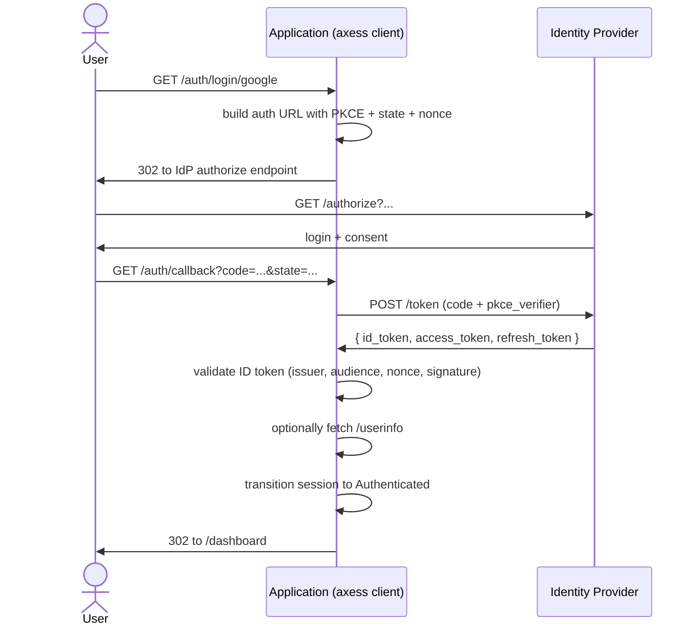

# OAuth 2.0 and OIDC

Federated login through an Identity Provider you do not control is
the most common reason to use OAuth. The user has a Google, Okta or
corporate Microsoft Entra ID account, and you accept a login from any of
them instead of asking for another password. OAuth 2.0 carries the
authorization flow and OpenID Connect the identity assertion on top of
it. This page separates what axess wires up from what your integration
code still owns.

The feature flag is `oauth` (off by default), enabled with
`features = ["oauth", "jwt-rust-crypto"]` on the `axess` facade. `oauth`
transitively enables `oidc` (the discovery and JWKS-cache machinery) and `jwt`
(the ID token validator), and `jwt` needs a crypto backend named beside it:
`jwt-rust-crypto` (pure Rust) or `jwt-aws-lc` (FIPS-capable, needs a C
toolchain).

Axess supports OIDC external login and SSO, including standard providers such as Google and Microsoft Entra ID configured with their issuer metadata and client credentials. SAML and Shibboleth federation are not supported out of the box.

## The shape of the flow

A federated login involves the user, the application (the OAuth
client, which axess implements) and the Identity Provider (the
authorization server, run by a third party). The flow is the
authorization code grant with PKCE, which every modern OIDC deployment
uses.



Axess owns six pieces of the flow:

- the PKCE verifier and challenge
- the CSRF state, generated and bound
- the OIDC nonce, generated and bound
- discovery of the IdP's endpoints and signing keys
- the token exchange
- ID token validation: signature, audience, nonce, and `azp` when the
  audience is multi-valued

Your integration owns three:

- the redirect to the IdP authorize URL
- the callback handler that picks up the code
- mapping validated claims onto a user record in your identity store

## Configuring a provider

You do not implement the provider trait; `discover` reads the IdP's own document into a
builder, and `build` checks its settings and returns the provider.

### The provider

`OAuthProvider` is the trait that represents an IdP. It is
asynchronous because any method may fetch JWKS, run discovery or call
the token endpoint. Adopters do not normally implement it: the
`OAuthProviderConfig` constructor in `axess-factors` builds a provider
that implements it from a discovery URL and client credentials.

```rust,ignore
let provider = OAuthProviderConfig::discover(
    "google",
    "https://accounts.google.com",
    client_id,
    client_secret,
    "https://your-app.example.com/auth/callback/google",
)
.await?
.build()?;
```

Discovery runs under `EgressPolicy::screened()`: the issuer URL, every
endpoint the document names and the addresses each request connects to must
be HTTPS to a public address. To discover an identity provider on your own network, or a mock on
loopback in development, call `discover_screened` with the policy named:
`EgressPolicy::unscreened()` or
`EgressPolicy::screened_allowing_loopback_http()`.

`discover` returns an `OAuthProviderBuilder`. Its `with_*` methods each
record a setting and return the builder, and may be called in any order;
`build` is the one place the settings meet. It checks the transport of every
endpoint a setter named, the FAPI profile's demands, the DPoP setting
against the profile and the IdP, and the ID-token algorithm list. A
provider that cannot work fails at startup with a `Config` error naming
the rule. The order of the calls does not change the result, except that a
later call to the same setting replaces an earlier one (`with_dpop()` and
`without_dpop()` are one setting).

`discover` fetches the IdP's discovery document, which must name the
authorization endpoint and the JWKS URI. It reads the token, userinfo,
end-session, revocation and PAR endpoints when the document names them,
checks the transport of every endpoint it read, and fetches the IdP's
signing keys into the JWKS cache. A call that needs an endpoint the
document did not name fails when it is made. The
cache is single-flight (concurrent JWKS misses dedupe to one request)
and debounced (the cache refuses to refresh more often than once
every few seconds, defeating a denial-of-service that triggers
constant JWKS fetches).

The configuration record carries four things:

- The client id and secret, both provisioned at the IdP.
- The redirect URI, where the IdP sends the user after authentication.
- The ceremony timeout: how long the intermediate state on the session
  may live before the flow has to restart.
- The scopes to request. `openid` and `profile` at minimum; `email` for
  the user's email address; `offline_access` for a refresh token, to
  keep acting as the user after the initial session expires.

### Authenticating the client

The code exchange, the refresh, the pushed authorization request and
the revocation call each prove who the client is. There are two ways to
do it, and a provider uses exactly one.

A **client secret** is what `OAuthProviderConfig::discover` takes. It
travels in the request as a Basic header (RFC 6749 section 2.3.1) on
every call that authenticates the client, so whoever can read the request or the secret
store can impersonate the client.

**`private_key_jwt`** (RFC 7523, OpenID Connect Core section 9)
replaces the secret with a signature. Axess signs a short-lived JWT, the
client assertion, with a private key whose public half the IdP holds,
and sends it as `client_assertion` beside
`client_assertion_type=urn:ietf:params:oauth:client-assertion-type:jwt-bearer`.
Nothing the IdP could leak can be replayed: each assertion lives 60
seconds and carries a fresh `jti`. Microsoft Entra requires this
method for a certificate credential, and FAPI 2.0 allows only this
method or mTLS.

```rust,ignore
use axess::federation::oauth::{ClientAssertionSigner, OAuthProviderConfig};

let signer = ClientAssertionSigner::from_pem(client_id, &private_key_pem, jsonwebtoken::Algorithm::PS256)?
    .with_key_id("2026-10")                 // IdPs that pick the key by kid
    .with_x5t_s256(certificate_thumbprint); // Entra: the certificate's SHA-256 thumbprint

let provider = OAuthProviderConfig::discover_with_private_key_jwt(
    "entra",
    "https://login.microsoftonline.com/<tenant-id>/v2.0",
    signer,
    "https://your-app.example.com/auth/callback/entra",
)
.await?
.build()?;
```

`with_private_key_jwt` on the builder that `discover` returns switches the
provider the same way and drops its secret: while a signer is set, no request carries
a `client_secret` or a Basic header. `ClientAssertionSigner::from_pem`
reads a PKCS#1 or PKCS#8 RSA key and a PKCS#8 EC or Ed25519 key;
`ClientAssertionSigner::new` takes a `jsonwebtoken::EncodingKey` you
built yourself. Both refuse a symmetric algorithm and sign one throw-away
assertion, so a key that does not suit its algorithm fails with a
`ClientAssertionError` at startup. The same signer authenticates the
outbound client (`ClientAuthMethod::PrivateKeyJwt`) and, through a stored
`SignerSpec`, a tenant's provider.

An RSA key (`RS*`, `PS*`) signs on the `jwt-aws-lc` backend, where axess
installs `jsonwebtoken`'s aws-lc crypto provider. Elsewhere its
signature may run in `rsa` 0.9, whose private-key operations leak timing
(RUSTSEC-2023-0071). That happens on `jwt-rust-crypto` alone, and in a
build that compiles both backends when the application or another crate
installed a provider before axess did: that provider may then be
RustCrypto's, and `jsonwebtoken` cannot report which one is in place.
In those builds `from_pem`, `from_spec` and `new` refuse an RSA algorithm with
`ClientAssertionError::RsaNotChosen` before the key is read, unless the
`client-assertion-rsa` feature names that choice. To sign RSA in aws-lc-rs,
build with `jwt-aws-lc` and leave installing the provider to axess. An
ES256, ES384 or EdDSA key needs neither.

The assertion's `iat` and `exp` come from the provider's clock
(`with_clock`) and its `jti` from the provider's RNG (`with_rng`), so a
test under a `MockClock` and a seeded `MockRng` reproduces it exactly.
Its `aud` is the endpoint being called, which is what Entra and Keycloak
accept; under [`with_fapi`](fapi.md) it is the issuer, as FAPI 2.0
requires, and `ClientAssertionSigner::with_audience` fixes one value for
an IdP that wants something else. FAPI composes with the method: DPoP or
mTLS constrain the tokens; the assertion authenticates the client. DPoP
does not need FAPI: see [Binding tokens to a key](#binding-tokens-to-a-key-dpop),
which works with a client secret too. `build` refuses a FAPI provider that
would authenticate by a secret, whatever order the settings came in.

If the IdP answers `invalid_client`, check in this order: the public key
or certificate registered for the client is the one that signs; the
`kid` or thumbprint header names it; the clock of the host is right (the
assertion lives 60 seconds); the `aud` is the value the IdP expects.

### Multiple providers

Many applications offer login with several IdPs side by side
(Google, GitHub, Microsoft). Each provider is its own
`OAuthProvider` instance constructed at startup; your code
registers them under a `provider_name` key. The login URL carries
the provider name (`GET /auth/login/google`); the callback URL also
carries the name (`GET /auth/callback/google`). Axess dispatches to
the right provider per request.

A per-tenant variation is also common: each tenant's users federate
against the tenant's own IdP (an Okta workspace, a Microsoft Entra ID
directory). Registering one provider per tenant at startup breaks when a
tenant is added or edited while the service runs; the
[Bring your own IdP](#bring-your-own-idp-per-tenant) section below
resolves the provider by `(tenant, name)` from a store at request time
instead.

### Bring your own IdP per tenant

A product where every customer signs in with its own IdP needs the
provider chosen by `(tenant, name)` at request time, from configuration
an operator edits while the service runs. Two tenants may each have a
provider called `sso`, against different issuers, in one process.

The pieces:

- `TenantOAuthProviderRecord` is one tenant's provider: issuer, client
  id, redirect URL, scopes, a `TenantClientCredential`, either a
  secret or a `private_key_jwt` key (the PEM, and a `SignerSpec`: algorithm,
  `kid`, certificate thumbprints, audience, assertion lifetime), and `dpop`, a `TenantDpop` with the three behaviours of
  [DPoP](#binding-tokens-to-a-key-dpop): `Advertised` (DPoP on where the
  tenant's IdP advertises it; the default, and what a stored record
  without the field reads as), `Off` (as `without_dpop()`, for a tenant whose
  resource servers accept only Bearer tokens) and `Required` (as
  `with_dpop()`: the provider is not built, and the login is refused,
  when the IdP does not advertise DPoP), and `kind`, the
  `FederatedProvider` every login through the provider records (`None`,
  the default, records `Custom(name)`; a record without the field reads as
  `None` and is written without it).
- `TenantOAuthProviderStore` keeps records.
  `MemoryTenantOAuthProviderStore` is for tests and fixed tenant lists;
  `SqliteTenantOAuthProviderStore` (the `sqlite` feature) keeps them in a
  `tenant_oauth_providers` table. The store assigns each record a
  `revision`: 1, then one more per update. The store also limits each
  `(issuer, client_id)` pair to one record, whichever tenant owns the
  records (a tenant's own second record of a pair under another name is
  refused too). It enforces this atomically (the SQLite store with a unique
  index) and answers `TenantOAuthProviderStoreError::pair_held()` for a
  write that would take a held pair. A store of your own must do the same:
  two records of one pair make that client's back-channel logout ambiguous,
  and the directory's own check holds within one process only. (The
  directory applies the same rule first, so that its refusal says which
  kind of registration holds the pair and nothing is sealed or written.)
- `StoredTenantOAuthProviders` is the `TenantOAuthProviders` over a
  store. It discovers and builds a provider on first use and keeps it.
  Each resolution reads the record and compares revisions, so an update
  written by any process is used by the next login with no restart and no
  call to make; `invalidate` drops a provider early, and `remove` deletes
  a record and stops it resolving.
- `StoredTenantOAuthProviders::new(store, cipher, ownership)` takes the
  `FactorSecretCipher` you already use for OTP secrets, and `upsert` seals
  the credential with it, bound to the tenant and the name, so the client
  secret or private key is never in the table in clear text and a row
  copied to another tenant does not open. The credential is also bound to
  the issuer, client id, redirect URL, scopes, DPoP mode, credential kind
  and signer spec, so a row rewritten in the store does not open either. A
  record sealed by 0.15 to 0.19, bound to the issuer and client id only,
  is moved to the current binding when the directory starts: `started()`
  runs `reseal_earlier_bindings()`, which lists every record
  (`TenantOAuthProviderStore::list_all`) and re-seals each credential due a
  re-seal with one `put_if_revision`. It logs its counts and returns them as
  a `ResealReport` (`moved`, `not_moved`). When a credential opens under no
  binding the cipher knows, it refuses to start and names the record. A
  second pass moves nothing. A directory that was not started runs the
  same pass before its first resolution and resolves nothing until the
  pass succeeds. A store whose `put_if_revision` returns
  `put_if_revision_unsupported()` writes nothing and loses nothing: the
  pass counts each such record in `not_moved` and names it in a warning.
  At use, the cipher's `with_earlier_tenant_binding` policy decides
  whether a credential still under the earlier binding opens (one the
  store could not move, or one a 0.19.0 node wrote during a rolling
  upgrade). Under the default, `LegacyBlobs::Reject`, it is refused, and
  the refusal is logged at `warn` with its tenant, its provider and the
  earlier binding as the reason. Under `Accept` or `AcceptUntil(cutoff)`,
  set explicitly, it opens and is re-sealed under every field on first use, or
  serves with a warning on each use when the store cannot write the move.
  `new_unencrypted(store, ownership)` is for tests and development only.
- Whoever registers an `(issuer, client_id)` pair first holds it, so the
  directory stores a record only once the tenant's ownership of the client
  is proven. The constructors' `OwnershipProofs` names the proofs a
  deployment accepts, for every tenant (`accept`, `or_accept`) or for one
  (`for_tenant`), with no default; every write (`upsert`, `upsert_attested`
  and an operator's hand-over) checks them before it stores, and refuses the
  record with
  `OAuthError::Config` naming only the kind of each proof's refusal (not
  authenticated, unproven, public client, not attested). What the provider
  answered (its error code and HTTP status, or a transport failure) is
  traced as a warning and never shown to the tenant, since the tenant
  chose the issuer.
  `TokenEndpointProbe` makes a token request to the provider as the
  client, with the record's credential (`client_secret_basic`, or
  `with_client_secret_post()`, or the `private_key_jwt` assertion), for an
  authorization code the provider never issued, through the directory's
  egress policy. `invalid_grant`, `unauthorized_client`,
  `unsupported_grant_type` or `invalid_scope` with HTTP 400 prove the
  client (the provider authenticated it before refusing the grant, RFC 6749
  section 5.2); `invalid_client` with HTTP 400 or 401 refuses it; any
  other answer (a grant error under another status included), a token, a
  redirect or a failure refuses it as unproven. A refusal of the grant
  counts only when the same request with a credential known to be wrong
  (the secret with its last letter or digit changed to another of its
  class, so its length, characters and prefix match, or the assertion with
  the lowest bit of its signature flipped), sent once before the client's
  own request and once after, is refused as `invalid_client` both times. A
  provider that skips client authentication for a client it holds as
  public, checks the code first, or checks only a secret's length or
  characters refuses a control as it refuses the client; one that
  rate-limits or fails between the requests answers a control otherwise.
  Either way the record is refused as unproven until an operator attests it. A
  first control not refused as `invalid_client` ends the probe before the
  client's credential is sent. The probe detects a provider that ignores
  the secret's value, not one that validates a structured secret's format
  (a checksum, a canonical base64 suffix) and then skips the value check:
  one changed character cannot keep a checksum valid, so the control fails
  the format while a guess formed correctly passes it and reads as proven.
  For tenants of a provider that issues structured secrets and may check
  only their format, accept the attestation alone:
  `OwnershipProofs::accept(TokenEndpointProbe::new()).for_tenant(tenant,
  OperatorAttestation)`.
  `OperatorAttestation` holds when the write carries an
  `OwnershipAttestation`, which only
  `RequestAuthnService::attest_tenant_oauth_client_as(operator, &record,
  purpose)` makes for the record's tenant, provider name and pair, after
  writing a `MethodEnabled` row naming the operator, the tenant, the
  provider (by the kind the record is configured with), the pair and the
  write it is for (`CLIENT_OWNERSHIP_ATTESTED_REASON`, then
  `purpose=register` or `purpose=hand_over`); it is the only route for a
  public client, whose secret is empty. An attestation made for one
  `OwnershipPurpose` is refused for the other. It is not `Clone` and a
  write takes it by value, so each write needs an attestation, and an
  audit row, of its own.
  The attesting operator is a deployment operator who checks ownership out
  of band (with the identity provider's administrator, in its console): an
  active user the identity store places in `TenantId::SYSTEM`, the tenant
  axess reserves for platform-operator principals and keeps self-service
  signup out of. The service refuses the following, each with a failure row: a user of the tenant
  it would attest for, an operator attesting `TenantId::SYSTEM` included
  (`ProviderChangeError::OperatorActsForTenant`); a user of any other tenant
  (`NotADeploymentOperator`), so a party that holds two tenants cannot have
  one attest for the other; an operator whose
  account is not `Active` as of the service's clock, suspended or pending
  verification (`OperatorNotActive`); the reserved
  `UserId::SYSTEM` (`OperatorIsSystemUser`), which automated paths such as
  seeding and signup act as and which names nobody who checked ownership;
  and a user it does not know (`OperatorUnknown`).
  Create your operators in `TenantId::SYSTEM`.
  A check of your own implements
  `ClientOwnershipProof`. An `upsert` of a pair another record holds is
  refused before any proof runs, with no request to the provider; for a
  free pair the probe makes up to four requests (the discovery document,
  the first control, the client's own token request and the second control)
  from your deployment's address on each call, so rate-limit registrations
  per tenant on the path that accepts them, with a setting of its own:

  ```rust,ignore
  /// Tenant OAuth registrations a tenant may make per hour; each may send
  /// four requests to the identity provider it names.
  pub const TENANT_OAUTH_REGISTRATIONS_PER_HOUR: u32 = 10;

  let made = registrations.count_in_last_hour(&tenant_id).await?;
  anyhow::ensure!(
      made < TENANT_OAUTH_REGISTRATIONS_PER_HOUR,
      "too many identity provider registrations this hour"
  );
  tenants.upsert(record).await?;
  ```
- `store()` returns the records read-only (`TenantOAuthRecords`: `get`,
  `list`, `list_by_issuer`, `list_all`). Every write goes through the directory, so
  none skips the proof, the egress check, the pair rule or the sealing; a
  write that must bypass them, for a migration or a repair, uses the store
  handle you built the directory from. Build the directory over an `Arc` of
  the store (an `Arc` of a store is a store) and keep a clone; never hand
  the clone to a path a tenant reaches.
- `reprove(tenant, name)` runs the accepted proofs against a stored record
  as a registration would and writes nothing: `Reproved::Proven`,
  `Reproved::Refused` with the refusal, or `Reproved::NoRecord`. A record
  stored before the directory asked for proof keeps serving; run `reprove`
  over every stored pair (`list` per tenant), and hand each refused pair to
  its owner or remove the record. An `OperatorAttestation` never holds
  there, since no attestation is offered.

```rust,ignore
use axess::federation::oauth::{
    OperatorAttestation, OwnershipProofs, OwnershipPurpose, SqliteTenantOAuthProviderStore,
    StoredTenantOAuthProviders, TokenEndpointProbe,
};

let store = SqliteTenantOAuthProviderStore::new(pool);
store.init_schema().await?;
// Confidential clients prove themselves to their IdP; an operator attests
// a public one.
let ownership = OwnershipProofs::accept(TokenEndpointProbe::new()).or_accept(OperatorAttestation);
// `started` moves every earlier-binding credential, or names the one it
// cannot open.
let tenants = Arc::new(
    StoredTenantOAuthProviders::new(store, cipher, ownership)
        .started()
        .await?,
);

let authn = AuthnService::builder(identity, factors)
    .with_tenant_oauth_providers(tenants.clone())
    .build();

// An operator saves a tenant's IdP; the next login uses it. A confidential
// client proves itself to its IdP; a public one carries an attestation,
// made by an active operator of `TenantId::SYSTEM`.
tenants.upsert(record).await?;
let attestation = authn
    .with_audit_context(audit)
    .attest_tenant_oauth_client_as(&operator, &public_record, OwnershipPurpose::Register)
    .await?;
tenants.upsert_attested(public_record, attestation).await?;

// Login: the tenant comes from the route or the host, never the body.
let (url, _state) = authn
    .begin_oauth_login_with_tenant_provider("sso", &OAuthLoginOptions::default(), &tenant_id, &session)
    .await?;
```

`begin_oauth_login_with_tenant_provider` takes the arguments of
`begin_oauth_login_in_tenant` in the same order. It stores the tenant in the
server-side session and binds the ceremony to it, as
`begin_oauth_login_in_tenant` does:
`complete_oauth_login` refuses a user of another tenant. The callback
(`finish_oauth_login`, or the JARM form) reads the tenant from the session,
so the callback request chooses neither the tenant nor the provider. The
handler passes the route the callback arrived on, and that route must be
this tenant's for this provider. A ceremony begun before an update does not
finish against the new issuer; it fails the issuer check and the login
restarts.

**The redirect URI of a tenant's provider carries the tenant.** Two
tenants' providers of one name are two authorization servers, and a
provider name alone does not tell their callbacks apart. Give each record a
`redirect_url` with the tenant in its path,
`https://app.example.com/auth/callback/{tenant}/{provider}`, register that
URI at the tenant's identity provider, and mount one route for the shape.
The handler reads both segments from the path the server routed, never from
a query parameter or a body, and passes them as the callback route:

```rust,ignore
async fn tenant_callback(
    session: AuthSession,
    State(authn): State<Arc<AuthnService<...>>>,
    Path((tenant, provider)): Path<(TenantId, String)>,
    Query(callback): Query<CallbackQuery>,
    audit: AuditContext,
) -> impl IntoResponse {
    let claims = authn
        .with_audit_context(audit)
        .finish_oauth_login(
            OAuthCallbackRoute::of_tenant(&tenant, &provider),
            &callback.code,
            &callback.state,
            callback.iss.as_deref(),
            &session,
        )
        .await?;
    // resolve the local user, then complete_oauth_login
}
```

`finish_oauth_login` refuses a callback on any route but the one of the
registration the login began with, before the code is exchanged: another
tenant's route for a provider of the same name, the global route
(`OAuthCallbackRoute::global`) for a tenant's provider, and a tenant's route
for a global one. Without the tenant in the comparison, a tenant whose
identity provider is hostile could send a user on to another tenant's
honest one and have the code that comes back posted to its own token
endpoint. A login begun with `begin_oauth_login_in_tenant` uses the global
registration's provider and returns on that provider's redirect URI, so its
route is the global one.

The global registration stays as the single-tenant form. A name
registered with `with_oauth_provider` is reached by `begin_oauth_login`
and a tenant's by `begin_oauth_login_with_tenant_provider`; the two never shadow each
other.

The helpers that follow the login resolve the provider the way the login
did. `oauth_for_session(&session)` reads the tenant that
`complete_oauth_login` recorded for a login begun with
`begin_oauth_login_with_tenant_provider` and returns a `ScopedOAuth`; its `refresh_oauth_token`,
`fetch_userinfo`, `build_end_session_url`, `generate_dpop_proof` and
`revoke_oauth_token` reach that tenant's provider. A session that logged in through the global registration, or through no
OAuth provider, gets the global registration, so a single-tenant product
changes nothing. Where there is no session (a background refresh keyed by a
stored tenant id) use `oauth_in_tenant(&tenant)`. For a tenant with no provider
by that name the call fails with `OAuthError::UnknownProvider`; it never
falls back to the global one. Where
there is neither a session nor a tenant (a job that revokes a stored token of
a provider every tenant shares) use `oauth_global()`, which reads the global
registration by name.

```rust,ignore
let authn = authn.with_audit_context(audit);

// A request of a signed-in tenant user.
let outcome = authn
    .oauth_for_session(&session)
    .await
    .refresh_oauth_token("sso", &refresh_token, &subject, nonce.as_deref(), key.as_ref())
    .await?;

// A worker that holds the tenant id.
let info = authn
    .oauth_in_tenant(&tenant_id)
    .fetch_userinfo("sso", &access_token, &subject, key.as_ref())
    .await?;
```

A revocation writes two `LogoutAttempt` audit rows naming the provider and,
where the scope has them, the session's user and the tenant, under one
`request_id`: a
request row before the provider is asked (a `Failure` with the reason
`OAUTH_REVOCATION_REQUESTED_REASON`), and an outcome row after it answers
(`Success`, its refusal, or unconfirmed when it did not answer). When the
request row cannot be written nothing is sent and the call answers
`OAuthError::AuditStore`; when the outcome row cannot be written the call
answers `OAuthError::AuditStore` with what the provider answered, and the
token may be revoked.

No helper takes a provider by its name alone. A name is unique only inside
one tenant's providers or the global registration, and a token sent to the
wrong one of two providers of a name is disclosed to it, so every call
names its scope. A single-tenant product writes `oauth_for_session(&session)`
in a request and `oauth_global()` in a worker.

An IdP-initiated logout arrives with no session and no tenant, only an issuer.
Build the back-channel handler with the tenant source so it finds the
provider by that issuer:

```rust,ignore
let handler = BackChannelLogoutHandler::for_tenants(
    authn.tenant_oauth_providers().expect("configured"),
    registry,
    authn.sid_map(),
    clock,
)
.with_audit(authn.backchannel_logout_audit());
// Or, beside global providers:
// BackChannelLogoutHandler::new(&providers, registry, sid_map, clock)?
//     .with_tenant_providers(source)
```

The handler asks the source for every tenant provider of the token's issuer;
the one whose client id the token's `aud` names verifies it, and the session
the `(issuer, sid)` maps to is the one that ends. Two tenants may share an
issuer when their client ids differ. The sessions a token ends are the
verifying tenant's: the login path records the tenant beside each `sid`
mapping and subject record, and a token verified by tenant A's provider
neither finds nor ends tenant B's session, though both are for the same `sub`
under the shared issuer. A token verified by a global provider ends the
subject's sessions in every tenant, as the provider is shared. When two
tenants' providers share both the issuer and the client id, the token cannot
be attributed, and the handler refuses it with
`LogoutProviderError::Ambiguous` and ends nothing; give each tenant its own
client registration. `StoredTenantOAuthProviders::upsert` refuses to register
the second one (`OAuthError::Config`, "its issuer and client id are already
registered by another record"), whichever tenant holds the first, so a tenant
administrator cannot create the ambiguity for another tenant. Name the pairs
the global registration holds with
`with_global_registration(issuer, client_id)` so a tenant cannot take those
either. The first record to register a pair keeps it, so `upsert` stores a
record only once the tenant's ownership of the client is proven (the
`OwnershipProofs` above). When a tenant took another's client before the directory asked for proof,
`reprove` refuses its record, `holder_of(issuer, client_id)` names the
record that holds the pair, and
`RequestAuthnService::reassign_tenant_oauth_pair_as(operator, &tenants,
owner_record, attestation)` writes the owner's record and removes the one
that held the pair in a single store write, so the tenant that took the
pair cannot take it again in between. The owner's record proves itself as
any write does, or carries an attestation made for
`OwnershipPurpose::HandOver`, and the operator is a deployment operator
in `TenantId::SYSTEM`, as for an attestation. The hand-over writes a request row
before the store is asked (`CLIENT_PAIR_HAND_OVER_REQUESTED_REASON`), a
`Failure` that means pending, as the revocation request row does, so a
hand-over whose outcome was never recorded never reads as done; then,
under the same `request_id`, a `Success` row for the record stored and a
`MethodDisabled` row for each record removed, attributed to that record's
tenant (`CLIENT_PAIR_HANDED_OVER_REASON`), or a `Failure` row with the
refusal. Each row names a record's provider by the kind the record is
configured with, and the hand-over returns each record it removed, as it
was stored (`ReassignedPair::removed`). Count hand-overs by those outcome rows, not the request row. A store of your
own implements `TenantOAuthProviderStore::reassign_pair`, a required
method; one that cannot make the removal and the write one step returns
`reassign_pair_unsupported()` and changes nothing. A tenant provider that
matches a global one never shadows it: the global provider decides the
token, and the tenant's is ignored and logged. When the tenant source fails, the handler answers 503, so the IdP
retries.

## Back-channel logout across instances

The `sid` map and the subject registry that back-channel logout reads are in
the process that handled the login. Behind a load balancer without
stickiness the IdP's logout token can reach another instance, which finds no
mapping, answers `200` (the OpenID Connect answer for a session the endpoint
does not know) and leaves the session valid. Two things close that:

```rust,ignore
let client = fred::prelude::Client::new(config, None, None, None);
client.init().await?;
let store: Arc<dyn SidStore> = Arc::new(ValkeySidStore::new(client.clone()));

// The login path writes to the shared store...
let authn = AuthnService::builder(identity, factors)
    .with_sid_store(store)
    // ...
    .build();

// ...and every instance's handler reads it, and shares the replay log.
let handler = BackChannelLogoutHandler::for_tenants(source, registry, authn.sid_map(), clock)
    .with_sid_store(authn.sid_store())
    .with_replay_log(Arc::new(ValkeyReplayLog::new(client)))
    .with_metrics(session_metrics);
```

`SidStore` and `LogoutReplayLog` are traits, so a store of your own (SQL, say)
plugs in the same way. A sid store names a session by its `SessionKey`, as
the session store and the session registry do: no record it keeps holds a
value a cookie could carry. `ValkeySidStore` ages its keys out by time
instead of by the in-process map's capacity and prune (`with_sid_ttl`,
`with_subject_ttl`), so `with_sid_map_capacity` does not apply to it. Its
scripts address the records of a session together, so it puts its whole
prefix in a hash tag: every key begins `{<prefix>}:v2:` and the store's keys
share one slot on any cluster, with no hash tag of yours in the prefix. A
prefix that is empty or begins with `}` would split them, so a store given
such a prefix fails every call. The replay log's keys (`<prefix>:jti:...`)
need no shared slot: each of its scripts takes one key.

A login whose subject record or `sid` mapping the sid store cannot write is
refused (`AuthnError::NoFlow`) and its session ended, just as a login the
session registry cannot register is: no session exists that a logout from
the provider cannot reach. An outage of the sid store is therefore an outage of
federated sign-in; make the store as available as the session registry. A
logout whose store cannot be read is answered `503`, so the IdP sends the
token again.

`with_metrics` counts the tokens that verified but ended no session
(`back_channel_logout_unmatched`); the answer stays `200`. A rate that does not
fall points to instances that do not share a store, or to logouts for
sessions that already ended.

## Changing a provider on a running service

`reload_oauth_provider_as(actor, name, kind, candidate)` replaces or adds a
global provider and `remove_oauth_provider_as(actor, name)` takes one out;
`reload_tenant_oauth_provider_as` and `remove_tenant_oauth_provider_as` do the
same in a registry keyed by tenant and name (`LiveTenantOAuthProviders`). Each
is called on `authn.with_audit_context(audit)` and records the administrator
it names. `kind` is the `FederatedProvider` every login through the new
provider records, as `with_oauth_provider_of_kind` and a tenant record's
`kind` configure it, and the change's audit row names it. The candidate is the future of
`OAuthProviderConfig::discover(..)` finished with `.build()`, so discovery and
the issuer check run before the swap, and a refusal leaves the previous
provider serving. A login begun before the swap finishes only if the issuer is
unchanged. The live registry keeps an `(issuer, client_id)` pair to one
provider as the stored directory does: a tenant reload (by an administrator or
a `ProviderSource` follower) whose pair another tenant provider or a global
provider holds is refused as `ProviderReloadError::PairHeld`. It asks for no
proof of ownership: the providers are the adopter's, installed by an operator
through `reload_tenant_oauth_provider_as`, which records who did, so ownership
is checked on that operator's path. See
[live provider reload](../authentication/live-provider-reload.md).

## The login flow

The three steps a user passes through, in order.

### Begin the login

The handler that starts the federated login transitions the session
into a state that holds the PKCE verifier, the CSRF state, and the
nonce, and returns a redirect to the IdP's authorize URL with those
values bound in.

```rust,ignore
use axess::federation::oauth::OAuthLoginOptions;
use axess::{AuthnService, AuthSession};
use axum::response::{IntoResponse, Redirect};

async fn begin_oauth_login(
    session: AuthSession,
    State(service): State<Arc<AuthnService<...>>>,
    Path(provider_name): Path<String>,
) -> impl IntoResponse {
    match service
        .begin_oauth_login(&provider_name, &OAuthLoginOptions::default(), &session)
        .await
    {
        Ok((auth_url, _state)) => Redirect::to(auth_url.as_str()).into_response(),
        Err(e) => (StatusCode::BAD_REQUEST, format!("{e}")).into_response(),
    }
}
```

`begin_oauth_login` does three things:

1. Generates the PKCE verifier through `SecureRng` and derives the S256
   challenge that travels in the authorize URL.
2. Generates the CSRF state and the OIDC nonce, also through `SecureRng`,
   and stores all three in the session's intermediate state.
3. Composes the authorize URL from the client id, redirect URI, scopes,
   challenge, state and nonce, and returns it.

The redirect URI passed at this step must exactly match the one
registered with the IdP at provisioning time. A mismatch is the
most common reason a new federated login fails.

### Where the ceremony secrets live

Between the begin and the callback the in-flight ceremony sits in the
session's custom data: the PKCE verifier, the state, the nonce and, for a
provider that binds tokens, the DPoP key's seed. Axess does not seal those
fields one by one. They are as private as the session store: sealed whenever
the store was built with a `SessionCrypto` key (the Valkey, SQLite, Postgres
and MySQL stores seal the whole row), and plain text in the store only
through the plaintext constructors, which are for development and testing.
Run OAuth against a store built with a key, and treat read access to the
session store as access to an in-flight ceremony. The ceremony lasts at most
`ceremony_timeout`, and the callback removes it.

### Handle the callback

After the user authenticates and consents, the IdP redirects the
user to the registered redirect URI with a `code` and a `state` query
parameter, and an `iss` when it supports RFC 9207. The application's
callback handler picks these up and calls `finish_oauth_login` with the
route it is registered for (`OAuthCallbackRoute::global(name)` for a
provider of the global registration, `OAuthCallbackRoute::of_tenant(tenant,
name)` for one a tenant brought). Axess checks the state against what
was stored on the session (defeating CSRF), the route and `iss` against
the registration the login began with (defeating a mix-up), and performs the
token exchange.

```rust,ignore
async fn oauth_callback(
    session: AuthSession,
    State(service): State<Arc<AuthnService<...>>>,
    Path(provider_name): Path<String>,
    Query(callback): Query<CallbackQuery>,
    audit: AuditContext,
) -> impl IntoResponse {
    let authn = service.with_audit_context(audit);
    match authn
        .finish_oauth_login(
            OAuthCallbackRoute::global(&provider_name),
            &callback.code,
            &callback.state,
            callback.iss.as_deref(),
            &session,
        )
        .await
    {
        // Not signed in yet: resolve the local user from the claims,
        // then `authn.complete_oauth_login(&user, &claims, &session)`.
        Ok(claims) => todo!("resolve the user, complete the login, redirect"),
        Err(e) => (StatusCode::UNAUTHORIZED, format!("{e}")).into_response(),
    }
}

#[derive(serde::Deserialize)]
struct CallbackQuery {
    code: String,
    state: String,
    iss: Option<String>,
}
```

`finish_oauth_login` does six things:

1. Reads the PKCE verifier, CSRF state and nonce from the session's
   intermediate state.
2. Checks the callback's route against the registration the login began
   with, refuses a ceremony older than the ceremony timeout
   (`OAuthError::Expired`), cross-checks the supplied state against the
   stored one, returning `OAuthError::CsrfMismatch` if they disagree, and
   checks `iss` against the provider the login began with (the mix-up
   defence described under ID token validation).
3. POSTs to the IdP's token endpoint with the code, the PKCE verifier and
   the redirect URI, authenticating the client with its secret (a Basic
   header) or, under `private_key_jwt`, its client assertion.
4. Extracts the ID token, access token and optional refresh token.
5. Validates the ID token: signature against the cached JWKS, issuer,
   audience, nonce, expiry, and `azp` when the audience is multi-valued.
6. Clears the ceremony from the session, leaves a claim lock bound to this
   provider, subject and session, and returns the `OAuthClaims`.

The session is not signed in yet. The application resolves the local user
from the claims (find or create) and calls `complete_oauth_login(&user,
&claims, &session)`, which checks the claim lock and the ceremony's tenant
and transitions the session to `Authenticated`. Userinfo is a separate call,
`fetch_userinfo`, for claims the ID token does not carry.

If any of the six steps fails, `finish_oauth_login` returns an
`OAuthError`. A failed token exchange or ID token check comes back as
`OAuthError::TokenExchange`. The provider's own error, such as the
`OAuthError::IdTokenValidation` described under ID token validation, goes
to the server log, so that no provider detail reaches the caller. The
session does not transition,
the intermediate state is cleared to prevent replay, and the callback
handler can render an error.

### ID token validation

Most of the security of an OIDC integration lies in ID token
validation. Axess performs the full set of checks RFC 6749 and OpenID
Connect Core 1.0 require, so integration code does not write them. The
checks are:

**Signature verification** against the IdP's JWKS. The
cache holds the current signing keys; if the ID token's `kid` header
does not match a cached key, the cache refreshes (subject to the
single-flight and debounce protections) and the check runs once more. A
signature that fails produces `OAuthError::IdTokenValidation`, carrying
the underlying reason as a string. A `kid` the refreshed JWKS still does
not contain produces `OAuthError::IdTokenValidation` too, with a string
saying that no key in the refreshed JWKS matches the ID token. That is
the one to alert on, because it usually means the IdP rotated keys in a
way the cache cannot follow.

**The issuer check.** The ID token's `iss` claim must
exactly match the discovery document's `issuer` field. A mismatch
indicates a misconfigured IdP, a discovery-document substitution
attack, or an attempt to replay an ID token from a different issuer;
all three produce `OAuthError::IdTokenValidation`. There is no
per-check variant: the enum carries one validation error whose string
names which claim failed, so match on the variant and log the string
rather than branching on the reason.

**The audience check.** The ID token's `aud` claim must
contain the client's registered client id. If `aud` is an array (which
happens when the IdP issues tokens valid for several clients), the
client id must be in it *and* the `azp` (authorized party) claim must
exist and equal the client id.
The `azp` check defeats a class of attacks where an ID token issued
for one client is replayed against a different client whose id is
also in the audience array.

**The nonce check.** The ID token's `nonce` claim must exactly
match the nonce `begin_oauth_login` generated and stored in the
session. The nonce defeats ID token replay: an attacker who captures
an ID token cannot reuse it against the same client, because a later
login has a different nonce.

**The expiry check.** The ID token's `exp` claim must be
in the future at the moment of validation, with a small clock-skew
allowance. The clock comes from the injected `Clock` trait, so DST
tests can exercise expiry handling deterministically.

ID tokens get no age bound on `iat` (issued-at).
The `openidconnect` verifier checks `exp` and the nonce but accepts any
`iat`, and axess does not add a maximum age: how recent a login is comes
from the single-use authorization code, the nonce bound to the session, the
ceremony timeout, and `exp`. (Logout tokens are different: their `iat` must be
within five minutes.) Under `with_fapi`, axess caps `exp - iat`.

**The mix-up defence** of RFC 9207, in two parts. First,
`finish_oauth_login` takes the route the callback arrived on, an
`OAuthCallbackRoute`: the `{provider}` of a `/callback/{provider}` route for
the global registration, the `{tenant}` and `{provider}` of a
`/callback/{tenant}/{provider}` route for a provider a tenant brought. It
refuses a callback on any route but the one of the registration the login
began with (another provider name, another tenant's provider of the same
name, the global route for a tenant's provider or the reverse), before the
code is exchanged: an authorization server that sent the browser on to
another one cannot have the other's code redeemed at its own token endpoint.
For this to hold, register one redirect URI per provider at each IdP,
and one per tenant for a tenant's provider. Second, the
method takes the callback's `iss` and compares it with the provider's
issuer exactly; a different one is refused the same way. A missing `iss` is
refused when the provider's metadata advertises
`authorization_response_iss_parameter_supported`, and accepted when it does
not. Both refusals are recorded as a `provider_mismatch` login failure and
clear the ceremony.

## Refreshing tokens

`refresh_oauth_token` returns a `RefreshOutcome`. The ID token of a refresh
response is optional (OIDC Core 12.2), so `id_token_claims` is `None` when the
IdP sent none; the rotated refresh token is returned either way and is the one
to store, because a rotating IdP has already spent the token that was sent.
When an ID token is present its signature, issuer, subject and nonce are
checked: a nonce, if present, must equal the nonce of the original login
(pass it as `original_nonce`; it is the `nonce` member of
`OAuthClaims::additional_claims`), and a missing nonce is accepted.

A login whose tokens are bound to a DPoP key passes that key as
`refresh_oauth_token`'s `dpop_key`; the next section says where it comes from
and why it has to be kept.

## Binding tokens to a key (DPoP)

A bearer token works for whoever holds it: one copied out of a log, a cache
or a compromised proxy is as good as the original. DPoP (RFC 9449) binds the
access token to a key the client holds. Every request that uses the token
carries a proof, a short JWT signed by that key and naming the request, and
the authorization server writes the key's thumbprint into the token
(`cnf.jkt`). A stolen token without the key is refused. DPoP binds the token
whatever the client authenticates with, a client secret included, and does
not need the FAPI profile.

**It is on by default where the IdP offers it.** `discover` reads
`dpop_signing_alg_values_supported` from the discovery document; when it lists
`ES256`, the algorithm axess signs proofs with, the provider binds its tokens
to a DPoP key with nothing configured. When the IdP does not advertise DPoP,
or advertises only other algorithms, the provider sends Bearer requests as
before, and there is nothing to do. `OAuthProvider::binds_to_dpop` says which
a provider does.

What a bound provider does:

- `begin_oauth_login` makes a key for the login and keeps it with the
  ceremony. The code exchange carries a proof signed by it; a response whose
  `token_type` is not `DPoP`, or whose access token names another key in
  `cnf.jkt`, is refused. The key comes back in `OAuthClaims::dpop_key`.
- Every later call with the tokens takes the key: the `dpop_key` argument of
  `refresh_oauth_token` and `fetch_userinfo`, the `dpop` argument of the
  provider's client credentials and device grants. A call given `None` is
  refused with `OAuthError::DpopKeyRequired` before anything is sent, because
  a bound token presented as Bearer is refused by a resource server that
  checks the binding, and accepted by one that does not. Revocation is the
  exception: a revocation issues no token, so `revoke_oauth_token` is sent
  when its `dpop_key` is `None` too, and with a proof when given the key.
- An authorization or resource server that wants a nonce answers
  `use_dpop_nonce` (RFC 9449 sections 8 and 9); the request is sent once more
  with a proof that echoes it. No other refusal is retried.

**Keep the key for the tokens' life.** Axess does not store it, and a key
made afresh does not match tokens already issued. Store its seed beside the
refresh token, as secret as the token itself, and restore it in whichever
process refreshes, after a restart or on another node:

```rust,ignore
use axess::federation::oauth::DpopKey;

// After the login: keep the seed with the refresh token.
let seed = claims.dpop_key.as_ref().map(|key| key.to_seed_bytes());

// Later, in any process: restore it and refresh with it.
let key = stored_seed.map(DpopKey::from_seed);
let outcome = authn
    .oauth_global() // or `oauth_in_tenant(&tenant)` for a tenant's provider
    .refresh_oauth_token("idp", &refresh_token, &subject, nonce.as_deref(), key.as_ref())
    .await?;
```

The OAuth example keeps the seed in its session beside the refresh token
(`examples/oauth/src/app.rs`). Sessions that were signed in before the
provider bound its tokens hold Bearer tokens and no key. A confidential
client's refresh token is not bound to a key (RFC 9449 section 5), so where
the IdP accepts it, those sessions refresh with a new key
(`DpopKey::generate`) and keep it from then on; otherwise they sign in
again.

**`without_dpop()`** turns DPoP off for a provider whose IdP advertises it.
It is the setting for deployments whose resource servers accept only Bearer
tokens: a bound token arrives at them with the `DPoP` scheme and a proof,
which they refuse. It gives up the binding, so use it only there.

**`with_dpop()`** makes DPoP a requirement: `build` refuses the provider when
the IdP does not advertise it, so an IdP whose configuration loses DPoP
fails at startup instead of issuing Bearer tokens. The later of the two
settings wins.

```rust,ignore
// Resource servers that take only Bearer tokens:
let provider = OAuthProviderConfig::discover("idp", issuer, client_id, secret, redirect)
    .await?
    .without_dpop()
    .build()?;

// DPoP or nothing:
let provider = OAuthProviderConfig::discover("idp", issuer, client_id, secret, redirect)
    .await?
    .with_dpop()
    .build()?;
```

Without PAR (the FAPI profile asks for it) the authorization request does
not name the key, so the code is not bound to it before the exchange; the
tokens are. Under [FAPI](fapi.md) with `SenderConstraint::DPoP` the pushed
request names it too (`dpop_jkt`), and DPoP is on whether or not the IdP
advertises it; `build` then refuses `without_dpop()`, and under FAPI with
mTLS DPoP is off and `with_dpop()` is refused.

## Endpoint transport

Every endpoint that receives a client secret, a token or a code (token,
userinfo, revocation, PAR, device authorization) must be HTTPS, with plain
HTTP allowed only for `localhost`, `127.0.0.1` and `[::1]`. Discovery refuses
a remote plain-HTTP endpoint, and `build` refuses one set by hand, so a
provider never holds an endpoint that would send a secret in the clear. The optional endpoints
(`end_session_endpoint`, `revocation_endpoint`, the PAR endpoint) are read
from the raw discovery document, since the typed metadata drops them.

## Logging out

Two mechanisms, driven from opposite ends.

### Back-channel logout

When the IdP supports OIDC back-channel logout, it sends a POST
to a registered logout endpoint at your application with a
`logout_token`. The application validates the token and, on success,
revokes the user's session.

The validation resembles ID token validation: the audience and issuer
checks apply, the `azp` check
applies when audience is multi-valued, and an additional check on
the `events` claim verifies the token is a back-channel logout token
(the URI `http://schemas.openid.net/event/backchannel-logout` must be
present). Axess implements this through `OAuthProvider::verify_logout_jwt`,
which returns the claims on success.

The token's `typ` header is checked as well. By default axess accepts
`logout+jwt`, the plain `JWT` and `Logout` spellings some IdPs send, and a
missing `typ`; it refuses the types of other tokens the same key signs
(`dpop+jwt`, `at+jwt`). For an IdP that sends the explicit type, call
`OAuthProviderBuilder::with_required_logout_typ` and any token whose `typ` is
not `logout+jwt` is refused too.

A token with a `sid` ends the one session that `sid` maps to; the subject's
other sessions are ended only when the token has no `sid` or the `sid` maps to
nothing. Providers that share an issuer are told apart by the client id the
token's `aud` names. The replay log of `jti` values is bounded per issuer;
when an issuer's share is full of live entries, that issuer's tokens are
answered 503 (retry later), no entry is evicted, and other issuers'
logouts are still served.
Userinfo is bound to the login the same way: `fetch_userinfo` takes the
expected subject and refuses a response for any other.

The sid store keeps the key the session's login registered, and a logout
finds the session by it for as long as the session lives, across rotations.
A step-up, `rotate_session` or `regenerate` moves the session to a new key;
given the key the login registered, the registry returns the key the
session is under now (`SessionRevoker::current_key`) and ends that session.
So a logout by `sid` or by `sub`, back-channel or front-channel, ends a
session that rotated after its login. The front-channel route compares the
caller's session with the key the session is under now, and the sweep of the
subject records keeps a session that rotated. A logout for a session that
has already ended ends nothing and reports nothing: no `SessionInvalidated`
row is written, the session's records go, and the token is counted as
unmatched (`back_channel_logout_unmatched`).

The size cap on the logout token is eight kilobytes, the `iat` bound
is five minutes, and the clock-skew tolerance is sixty seconds (the JWT
verifier's tolerance may be at most `MAX_LEEWAY`, 300 s, in whole seconds; a
configuration above it, or with a fraction of a second, is refused before any token is read, with an error naming the
bound). The
size cap protects against denial-of-service through oversize tokens;
the time bounds defeat replay of a captured logout token after a
meaningful delay.

### RP-Initiated Logout

The opposite direction is RP-Initiated Logout: the application
initiates a logout that propagates to the IdP, so the user is logged
out of the IdP session as well as your own. Axess
constructs the end-session URL through
`OAuthProvider::build_end_session_url`, which takes the ID token
hint (the user's last issued ID token, signed by the IdP), an
optional `post_logout_redirect_uri` (where to send the user after
logout), and an optional state value.

The `post_logout_redirect_uri` must be on an allowlist that the
application configures with `with_allowed_post_logout_redirect_uris`. The
allowlist exists to defeat open-redirect attacks: an attacker who can
manipulate the redirect URI could send the user to an arbitrary external site
after logout, a common phishing setup. The allowlist is a
small explicit list of URIs, matched exactly. A redirect that is not on the
list is dropped from the URL at `build_end_session_url` time, and so is every
redirect when the list is empty (the default): a provider nobody configured
forwards nothing.

## Threat model

With the validations above, OAuth and OIDC defend against the
following attacks.

Against CSRF on the callback: the state parameter binds the callback
to the session that started the login. An attacker who tricks a user
into hitting the callback URL with a stolen code cannot complete the
login because the state will not match.

Against ID token replay: the nonce binds the ID token to the
session's login attempt. An ID token captured by an attacker cannot
be replayed against a different session.

Against ID token forgery: signature validation against the JWKS
catches an attacker who synthesises an ID token without the IdP's
signing key.

Against audience confusion (an ID token issued for one client used
against another): the audience check plus the `azp` check on
multi-element audiences catch this.

Against authorization code interception: PKCE binds the code to the
verifier axess generated. An attacker who intercepts the
code cannot exchange it without the verifier.

Against open-redirect phishing on logout: the
`allowed_post_logout_redirect_uris` allowlist catches an attacker
who tries to manipulate the redirect URI.

The attacks OAuth and OIDC do not defend against are the ones FIDO2
defends against (real-time phishing of the IdP login page itself)
and the ones that depend on the IdP's own security posture (a
compromised IdP issues compromised tokens, and no client-side check
catches that). The defence for the latter is operational: monitor
which IdPs you accept, audit periodically, and rotate
the registered client secret if the IdP suffers a breach.

## Troubleshooting

A few failure modes recur during initial integration.

If the callback returns `OAuthError::Expired`, the user took longer than
the ceremony timeout to complete the IdP login, and has to start the login
again. The timeout defaults to ten minutes and is capped there, at the
authorization-code lifetime RFC 6749 section 4.1.2 recommends:
`with_ceremony_timeout` can shorten it, and a longer setting has no effect.
`OAuthError::NoFlow` means the session holds no ceremony: the callback
arrived without the session the login began in, or the ceremony was already
used. `OAuthError::CsrfMismatch` means the callback's `state`, route or `iss`
does not match the ceremony: a forged callback, one that came back on
another provider's redirect URI, or the callback of an earlier login after
a second one began in the same session.

If the token exchange returns an invalid-client error, the client id
or secret in `OAuthProviderConfig` does not match what the IdP has
registered. The most common variant is a client registered as public at the IdP
while axess is configured as a confidential client, or the reverse. Check the IdP's client registration page.

If the ID token validation returns an audience mismatch on an IdP
that supports multiple clients, the `aud` claim is probably an
array and the `azp` claim is missing. Some IdPs do not emit `azp`
when they should; the fix is to configure the IdP to issue `azp`.
Axess deliberately refuses to bypass the `azp` check because doing
so would open the audience-confusion attack.

If the userinfo endpoint returns a 401 after a successful token
exchange, the access token's scopes do not include the ones the
userinfo endpoint requires. The fix is to add the required scopes
(typically `profile` and `email`) to the `scopes` configuration.

## Pinning the token algorithms

By default an ID token is accepted when it verifies under a key the provider
published and its algorithm is one the provider advertised; a logout token,
when its algorithm is one of the asymmetric defaults. OpenID Connect Core
3.1.3.7 asks for the algorithm the client registered
(`id_token_signed_response_alg`, `RS256` unless registered otherwise). Name it with
`OAuthProviderBuilder::with_id_token_signing_algs(["RS256"])` and every other
algorithm is refused for both kinds of token. Under `with_fapi` the provider
accepts the algorithms the pin and the profile both name: a pin narrows the
profile and never widens it, and `build` refuses a pin the profile shares
nothing with. `docs/factors/conformance.md` shows why it matters: the suite signs a
logout token with a second algorithm under a published key and expects a 400.

## Further reading

*FAPI 2.0* covers the financial-grade extensions that layer on top of
the OAuth provider for regulated deployments: PAR (pushed
authorization requests, which send the authorize parameters
server-to-server instead of through the browser), DPoP under the
profile's rules (the binding described above, required and with the
code bound too),
and JARM (JWT-secured authorization response mode, which signs the
IdP's response back to the client).
*Workload identity overview* covers the inbound side, where your
service is the resource server that accepts tokens issued by federated
workload-identity systems and resolves them into a `Principal::Workload`.
*Local IdP* covers the in-process IdP, both production `LocalIdp`
for workload-identity issuance and the `LocalIdpFixture` that mints
test tokens against a controllable JWKS for integration tests.
