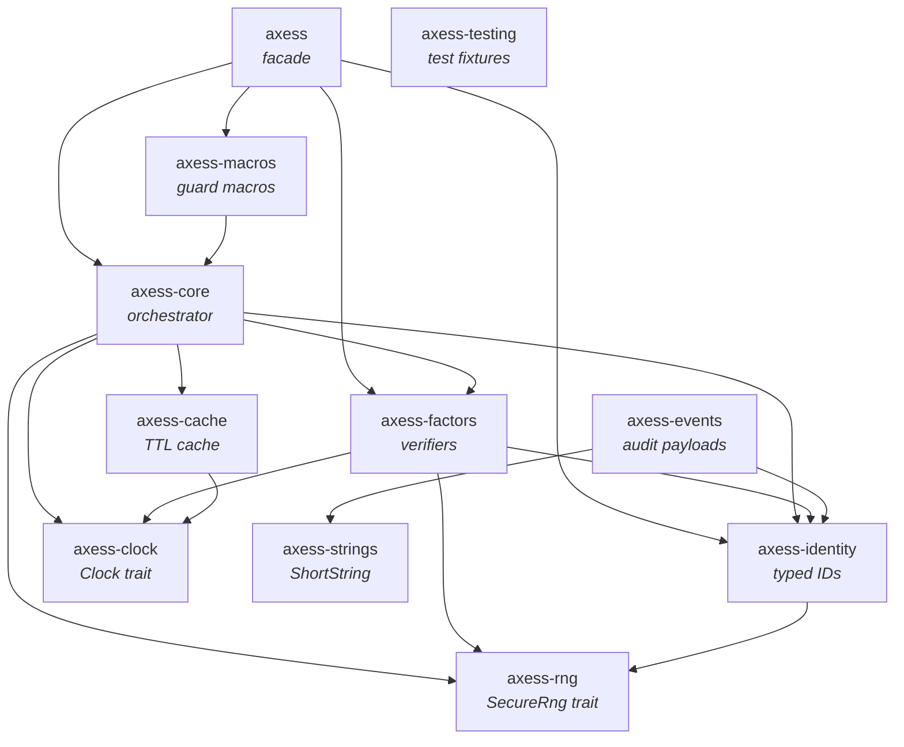
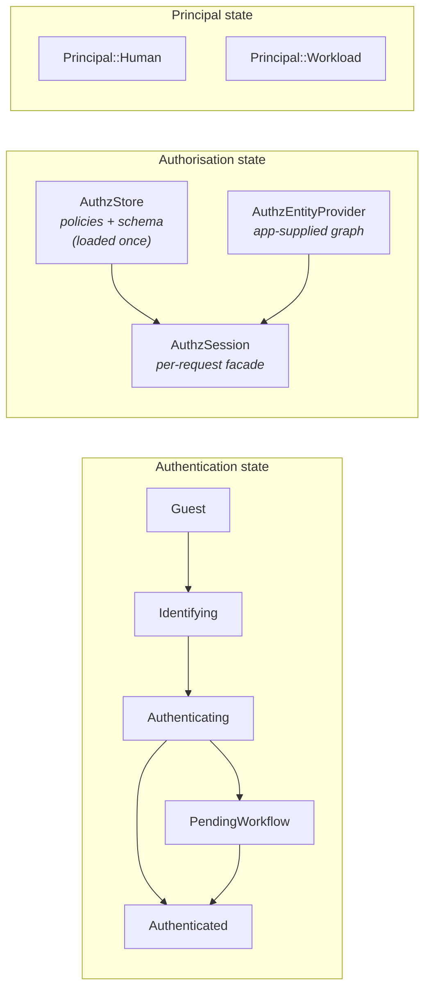

# Architecture at a glance

Which crate owns what, how the pieces compose, and where you plug in.
Four decisions carry the rest of the book: the
verifier-versus-orchestrator line, the three state slices, the
deterministic simulation testing (DST) foundation, and the naming
conventions. Later chapters build on these four.

Evaluating? Read it end to end. Mid-integration? Skim, and come back
when something surprises you.

## Workspace shape

Axess is eleven library crates plus a set of example applications. The split
does three things: it enforces a structural invariant (leaf crates do not
depend on the orchestrator), it spares adopters the compile cost of
features they do not use, and it makes the verifier-versus-orchestrator
line explicit in the dependency graph.



The `axess` crate is a thin facade that re-exports the curated public
API from `axess-core` and `axess-factors`. Application code depends on
this crate alone. The internal crates can be reorganised without
breaking adopters as long as the types the facade exposes stay
compatible.

`axess-core` is the orchestrator. It owns the session state machine,
`AuthnService`, `AuthzStore`, the Axum middleware stack (CSRF, rate
limit, request id, trace id), session storage backends, the
device-identity ladder, the workload identity resolvers, and the audit
dispatch. If a type drives a transition or owns persistent state, it
lives here.

`axess-factors` holds the per-credential verifiers. The list is long
because authentication has many kinds of credential:

- Argon2id, TOTP, HOTP, email OTP and recovery codes.
- FIDO2, LDAP bind and mTLS.
- OAuth and OIDC, with discovery, a JWKS cache and logout-token claim
  validation; plus JWT validation and the PKCE helpers.
- One generic resolver for JWT-bearer workload tokens (Kubernetes
  service accounts, GitHub Actions OIDC and the like); the per-issuer
  claim mappings are recipes in `examples/workload-identity`.
- A bearer-token extractor and an outbound OAuth client.

The crate is
composable on its own and is the extension point for a custom factor:
implement the verifier trait and register it with the service; nothing
else changes.

`axess-macros` depends on `axess-core`, whose types its guard macros
name. Everything else in the workspace is a leaf. Each leaf crate owns one
concept (typed IDs, TTL cache, the Clock trait) and depends on nothing in
the workspace but other leaf crates. The structural
invariant is that no leaf crate may depend on
`axess-core`. A leaf that `axess-core` itself depends on cannot depend on
it in turn, because Cargo refuses to build the cycle; for the other leaves
the rule is held at review.

## The verifier-versus-orchestrator line

The most important line in the workspace runs between `axess-factors`
and `axess-core`. Per-credential algorithms and their data shapes live
on the verifier side. The sum types and the composition machinery that
combine them live on the orchestrator side.

For example, the `Fido2Config` struct, the `Fido2Provider` trait,
and the WebAuthn ceremony itself live in `axess-factors`. The
`FactorKind::Fido2` variant, the `FactorConfig::Fido2(Fido2Config)`
wrapping, and the `FactorStep::factor(FactorKind::Fido2)` composition
helper live in `axess-core`. The same pattern applies to LDAP, to OAuth,
to every factor: the algorithm and its config are verifier-side; the
enum variant and the composition are orchestrator-side.

The line separates two kinds of change. The
verifier is the thing you might want to swap (an alternative WebAuthn
library, a custom OTP scheme, an LDAP binding that reads from a sidecar
rather than directly). The orchestrator is the thing you do not swap
(the state machine, the audit dispatch, the storage interface) but do
want to extend (add a factor, add a workflow, add a backend). Separate
crates make the swap and the extension independent. A change in `axess-factors` does not invalidate
orchestrator code; a change in `axess-core` does not touch the verifier
crates.

The line also shows up in the dependency direction. `axess-core`
depends on `axess-factors`, never the reverse.

## The one exception that proves the rule

`axess-core` hosts one piece of code that does not fit the
RP-side-orchestrator framing: the in-process IdP under
`crate::local_idp` (feature `local-idp`, off by default). `LocalIdp`
mints workload-identity JWTs on-host, which is OP-side issuance, not
verifier composition. It lives in `axess-core` by design. The choice is between two costs: carve `LocalIdp` into a
sibling crate that mirrors the verifier/issuer split in the workspace
layout, or accept one feature-gated OP-side module inside the
orchestrator crate. The carve-out was rejected for the reasons that retired the earlier
`axess-delegated` crate: the structural benefit is small, an additional
workspace member costs maintenance, and no adopter has asked for
`LocalIdp` as a separate dependency.
Adopters who do not enable `local-idp` pay nothing for it; adopters
who do enable it find it through `axess::local_idp::*` regardless of
which crate hosts the implementation.

The internal layout reflects the boundary even when the crate
boundary does not. Primitives shared between the production
`LocalIdp` and the test `LocalIdpFixture` live in
`axess-core/src/local_idp/primitives.rs`, outside the `testing/`
tree, so production code does not have to import from a test module.
The fixture itself stays under `crate::testing::local_idp` and
imports the primitives: test code depends on production code, never the
reverse.

## The three state slices

Most authentication libraries conflate three independent state machines
into one bag of fields and call the result a "session". Axess keeps
them separate: the slices answer different questions, change on
different cadences, and are owned by different concerns.



*Authentication state* is `AuthState`, the session state machine
covered in Part II. It transitions through factor verification, lives
inside `SessionData` behind a cookie, and is what `RequestAuthnService::verify_factor`
mutates. It answers the question *"is this caller authenticated, and to
what tier?"* It changes on factor verification, which is rare.

*Authorisation state* is `AuthzStore`, holding the Cedar policy set and
its schema, loaded once at startup. A per-request `AuthzSession` then
evaluates those policies against an entity graph that the application
supplies through an `AuthzEntityProvider`. It does not live in the
session; it is rebuilt fresh per request. It answers the question
*"is this principal allowed to perform this action against this
resource?"* It changes when policies are redeployed, which is even
rarer.

*Principal state* is `Principal { Human | Workload }`. A human
principal carries a `UserId` and `TenantId`; a workload principal
carries a `WorkloadId`. The principal is extracted from the
authentication state for humans and from a workload-identity resolver
(bearer JWT, mTLS, K8s service account, and so on) for non-humans. It
changes on every request.

Keeping the slices apart lets each evolve without disturbing the others.

## Deterministic simulation testing

Every place in axess that reads wall time or sources entropy on the hot
path goes through an injected trait. This makes the test suite
reproducible and turns subtle timing or ordering bugs into failing tests
rather than rare incidents.

Two traits carry the foundation. `Clock` is the first:

```rust,ignore
pub trait Clock: Send + Sync + 'static {
    fn now(&self) -> Timestamp;
}

pub struct SystemClock;          // reads std::time::SystemTime::now()
pub struct MockClock { /* ... */ } // advances under test control
```

The reading is a `Timestamp`, one of the time types axess-clock builds on
the standard library alone, alongside `SignedDuration` (an exact signed span),
`Until` (an end that comes at a reading or never) and `UtcDate` (a day in
UTC). Their arithmetic is checked: a result past the range is `None`, never
a panic.

`SecureRng` is the second:

```rust,ignore
pub trait SecureRng: Send + Sync + 'static {
    fn fill_bytes(&self, dest: &mut [u8]);
}

pub struct SystemRng;          // delegates to getrandom
pub struct MockRng { /* ... */ } // seeded; reproduces byte sequence
```

`SecureRng::fill_bytes` takes `&self`, not
`&mut self`, so one generator can be shared as `Arc<dyn SecureRng>`
without forcing every call site to plumb a mutable borrow through. A
generator with state therefore needs interior mutability: `MockRng` keeps
its seed behind a `Mutex`, which also serialises concurrent use at the
cost of one lock per fill. `SystemRng` holds no state and takes no lock.

`AuthnService<I, F>` holds `Arc<dyn SecureRng>` and
`Arc<dyn Clock>` as construction-time fields. The service is generic
over the identity store (`I`) and factor store (`F`) but type-erased
over clock and RNG, so swapping in `MockRng` or `MockClock` does not
change the service's type signature. Tests do this with
`.with_rng(MockRng::new(seed))` and `.with_clock(MockClock::default())`;
production wires `SystemRng` and `SystemClock`.

The same discipline extends to backends: the
production implementation talks to a real database or external service,
and a `Mock*` implementation does the same thing in memory under test
control.

| Trait | Production implementation | Test mock |
|---|---|---|
| `IdentityStore` / `FactorStore` | real database | `MockIdentityStore` / `MockFactorStore` |
| `SessionRegistry` | Valkey or memory | `MemorySessionRegistry` |
| `OAuthProvider` | HTTP plus JWKS cache | `MockOAuthProvider` |
| `Fido2Provider` | WebAuthn ceremony | `MockFido2Provider` |
| `LdapProvider` | LDAP directory | `MockLdapProvider` |
| `DeviceStore` | SQL or Valkey | `MemoryDeviceStore` |
| `DeviceResolver` | header or IP | `RedactedResolver`, `NoopDeviceResolver` |

A complete login, including session-registry interactions, factor
verification, refresh-token rotation and audit emission, can be
exercised in a `#[tokio::test]` with no database, no Valkey, no
network. The same test that detects a regression on a development
laptop detects it in CI without further configuration.

One exception: axum's `IntoResponse` for `AuthnError`, behind the
`default-error-response` feature. The trait method takes no arguments, so
it reads the wall clock to compute `Retry-After`. Anything that holds a
clock calls `AuthnError::into_response_at(clock.now())`, which is
deterministic, and the trait impl is only the convenience path.

## Storage backends

Identity persistence is adopter-owned. Axess does not prescribe a user,
tenant or factor schema, because every application already has one
and the schemas do not agree on much. It prescribes the trait surface
you implement, split into three tiers so that adopters write only what
they need.

The narrowest tier is `IdentityLookup`, with eleven read verbs (two of
them with default bodies). It is
enough to support a read-replica path or a test fixture. The middle
tier, `IdentityAuthnLog: IdentityLookup`, adds ten per-attempt verbs: the
audit event, the failed-attempt and throttle counters, and the last-login
time. It is required for production because lockout decisions depend
on those counters. The widest tier, `IdentityAdmin: IdentityAuthnLog`,
adds six verbs covering privileged provisioning, activation, suspension,
and GDPR erasure, and is required for any control-plane surface.

The umbrella alias `IdentityStore: IdentityAdmin` preserves the
all-three-tiers shape for production backends. `NoopAuthnLog` is an
adapter that wraps an `IdentityLookup` and satisfies the
`IdentityAuthnLog` signature with a no-op, suitable for fixtures and
read-replica contexts. Production must still implement `IdentityAuthnLog`
directly: the no-op disables lockout.

Session, refresh-token, and device storage have first-party backends
for the obvious targets:

| Trait | Memory | SQLite | Postgres | MySQL | Valkey |
|---|---|---|---|---|---|
| `SessionStore` | `memory` | `sqlite` | `postgres` | `mysql` | `valkey` |
| `SessionRegistry` | `memory` | adopter | adopter | adopter | `valkey` |
| `RefreshTokenStore` | `testing` | adopter | adopter | adopter | adopter |
| `DeviceStore` | `device` | `device, sqlite` | `device, postgres` | `device, mysql` | `device, valkey` |
| `DelegatedCredentialStore` | `delegated-stored` | adopter | adopter | adopter | adopter |

A cell in code font names the features that turn the implementation on.
The word "adopter" means axess defines the trait and provides a memory
implementation; the SQL or Valkey-backed implementation is yours. The
chapter *Identity store implementation* walks through the pattern, and
`examples/sqlite/` ships a complete one.

Session backends are also re-exported through the facade under the
`axess::backends::{sqlite, postgres, mysql, valkey, memory}` namespace.
Application code writes `use axess::backends::sqlite::{SessionStore, DeviceStore}`
rather than stitching together flat `SqliteSessionStore`,
`SqlDeviceStoreError`, and similar symbols. The grouping is a facade
detail; backend module paths inside `axess-core` are internal.

### The generic `Store<K, V>` surface

All five session backends also implement the generic
`axess_core::store::Store<SessionKey, SessionData>` trait (a session is
stored under its key, a digest of the id its cookie carries). Adopters who
want a backend-agnostic key/value-with-TTL surface (test doubles,
generic operations endpoints, multi-backend deployments) can hold a
generic `S: Store<…>` and dispatch uniformly. The trait returns `impl
Future` and has `Clone` as a supertrait, so it cannot be a `dyn Store`.
`SessionStore` stays the primary surface for session-domain operations
(`cycle`, `find_sessions_for_user`) because those carry primitives the
generic `Store` deliberately omits.

A fully codec-parameterised `SqlStore<K, V, C: Codec<V>>` was evaluated
and rejected. The dialect-specific SQL bodies are too thin to justify
the `sqlx::Database` bound noise: only `ON CONFLICT` versus
`ON DUPLICATE KEY UPDATE` plus three placeholder styles differ. The
slice that does dedupe cleanly lives in
`session/storage/sql_helpers.rs`.

## Naming conventions

A reviewer reading axess code can predict a type's responsibility from
its prefix and suffix. The conventions are tight on purpose; they let
you scan a module index without reading any function bodies.

### Type prefixes

| Prefix | Scope | Examples |
|---|---|---|
| `Auth*` | Shared across authentication and authorisation | `AuthSession`, `AuthState`, `AuthEvent`, `AuthMethod`, `AuthPrincipal` |
| `Authn*` | Authentication only | `AuthnService`, `AuthnError`, `AuthnScope`, `AuthnBackend` |
| `Authz*` | Authorisation only | `AuthzStore`, `AuthzSession`, `AuthzDecision`, `AuthzError` |

`Auth*` is shared infrastructure. `Authn*` is what you reach for when
handling a login attempt. `Authz*` is what you reach for when deciding
whether a request may proceed. If you see a function that takes
`AuthSession` and returns `AuthzDecision`, you know without opening it
that it is bridging authentication state into authorisation evaluation.

### Type suffixes

| Suffix | Meaning |
|---|---|
| `*Outcome` | Multi-variant result from an authentication operation (`LoginOutcome`, `FactorOutcome`, `SignupOutcome`) |
| `*Decision` | Binary allow/deny verdict (`AuthzDecision`) |
| `*Config` | Configuration or parameters (`SessionConfig`, `TotpConfig`, `RateLimitConfig`) |
| `*Store` | Persistence trait or implementation (`SessionStore`, `IdentityStore`, `DeviceStore`) |
| `*Registry` | Session validity tracking (`SessionRegistry`, `MemorySessionRegistry`) |
| `*Provider` | External integration trait (`OAuthProvider`, `Fido2Provider`, `LdapProvider`) |
| `*Resolver` | Extract typed value from a request (`DeviceResolver`, `PrincipalResolver`) |
| `*Error` | Error type (`AuthnError`, `OAuthError`, `CryptoError`) |
| `*Builder` | Builder pattern (`SessionConfigBuilder`, `AuthEventBuilder`) |

The public surface follows these conventions. New types adopt them, and
review catches violations.

### Method verb conventions

| Verb | Semantics | Examples |
|---|---|---|
| `get_*` | Lookup by primary key, deterministic, O(1) | `get_user(id)` |
| `find_*` | Search by business criteria, may scan | `find_user(identifier, tenant)` |
| `load_*` / `save_*` | Deserialise / serialise persisted state | `load_factor(scope, kind)` |
| `begin_*` / `complete_*` | Multi-step ceremony start / finish | `begin_login()`, `complete_oauth_login()` |
| `verify_*` | Check a credential or assertion | `verify_factor()` |

If you read `find_user_by_email`, you know it may be O(n) and may miss.
If you read `get_user`, you know the id was already validated and the
call should succeed unless the user was deleted.

### Visibility

Internal types for cross-module use within `axess-core`
(`SessionHandle`, `SessionInner`, `LoadOutcome`, `FinalizeOutcome`)
are `pub(crate)`. The public API surface is defined by the re-exports
in `axess-core`'s `lib.rs` and the facade in `axess`'s `lib.rs`. The
default for new types is `pub(crate)`; promotion to `pub` requires
concrete demand.

## Security invariants

Three invariants run through every part of the workspace. They are not
advice; they are enforced by lints, by review, and in some cases by
the type system.

**`#![forbid(unsafe_code)]`**, declared at the root of all eleven
published crates. There is no unsafe code in axess.

**Constant-time comparison** for any byte-level secret
check. HMAC cookie verification, TOTP code verification, OAuth CSRF
state, refresh-token device binding, session fingerprint: all of these
compare bytes through `subtle::ConstantTimeEq`. The alternative, `==`
on bytes, leaks timing information and is rejected at review.

**Zeroization on drop.** Password hashes are wrapped
in `ZeroizedString`. TOTP and HOTP shared secrets use `Zeroizing`, and
so do the session signing keys and the encryption keys. Zeroization narrows the exposure but does not close it: an attacker with
enough memory access can still read secrets.

The full production posture, including integration requirements and
compliance touch-points, is in *Security posture*.

## What lives where, in one paragraph

If you read nothing else from this chapter: state machines, storage,
middleware, the federation orchestration (the OAuth provider registry,
IdP-initiated logout), device identity, and OBO/delegated
access live in `axess-core`. The per-credential verifiers (Argon2id,
TOTP, HOTP, FIDO2, LDAP, mTLS, OAuth, OIDC, JWT) live in `axess-factors`. Typed IDs and the principal
enum live in `axess-identity`. Anything that reads time or
randomness goes through `axess-clock` or `axess-rng`. Adopters
depend on the `axess` facade; the internal split is free to
reorganise behind that boundary.

The rest of the book is detail.

## Further reading

- *The session state machine* covers the five-state machine in full,
  including `PendingWorkflow`.
- *Factors and methods* covers verifier composition, method authoring,
  and the scope hierarchy.
- *Cedar policy fundamentals* covers policy loading, the evaluator,
  and the entity provider contract.
- *Session lifecycle and crypto envelope* covers the cookie shape, the
  AES-256-GCM envelope, and fingerprint binding.
- *Contributing* covers how a change names its ROADMAP entry, the DST non-negotiable,
  and the naming conventions tied back to this chapter.
